# Automated Conveyor-Based Color Sorting System

<p align="center">
  
</p>

<p align="center">
  
  
  
  
  
  
</p>

<p align="center">
  <strong>A closed-loop electromechanical sorting platform featuring a 360° rotary carousel conveyor, real-time TCS3200 optical pulse-frequency acquisition, 3-sample debounce filtering, normalized Euclidean color error classification, and coordinated tri-servo divert actuation.</strong>
</p>

<p align="center">
  <strong>Developed by Aakar Gupta</strong><br>
  <em>Embedded Systems &amp; Hardware Automation</em>
</p>

---

## Repository Metadata

<div align="center">

| Field | Specification |
|:---|:---|
| **Repository Name** | `Automated-Conveyor-Based-Color-Sorting-System` |
| **Project Type** | Embedded Systems / Mechatronics & Hardware Automation |
| **Developer** | Aakar Gupta |
| **Target Controller** | Arduino Uno R3 (Microchip ATmega328P @ 16 MHz, 5V TTL) |
| **Optical Sensor** | TAOS / ams TCS3200 RGB Light-to-Frequency Converter |
| **Actuator Topology** | 1x Continuous Rotation Drive Servo (D10) + 2x TowerPro SG90 9g Micro Servos (D11, D12) |
| **Firmware Architecture** | Non-Blocking Finite State Machine (4 States) with `millis()` Scheduling |
| **Telemetry Interface** | USB CDC Serial Monitor (9600 Baud, 8-N-1) |
| **Demonstration Media** | Single-cycle video (`media/videos/test1.mp4`, 34.9s) &amp; Full-HD multi-package demonstration (`media/videos/24BRS1321,1034 Project Video.mp4`, 72.6s, 1080p) |

</div>

<div style="border-left: 6px solid #0284c7; background: #0f172a; padding: 14px 18px; margin: 18px 0; border-radius: 4px; color: #f8fafc;">
<strong>System Highlight:</strong> Unlike conventional open-ended linear conveyor lines, this implementation utilizes a continuous-loop rotary carousel turntable paired with an optical hood and 20% frequency-scaled photodiode reads. Packages are identified in flight under active illumination, tracked across a 3200 ms transit arc, and mechanically diverted into dedicated sorting chutes without blocking firmware execution.
</div>

---

## Table of Contents

<div align="center">

| # | System Design & Engineering | # | Operations, Media & Reference |
|:---:|:---|:---:|:---|
| 1 | [Executive Summary](#1-executive-summary) | 12 | [Calibration & Tuning Guide](#12-calibration--tuning-guide) |
| 2 | [Problem Statement & Motivation](#2-problem-statement--motivation) | 13 | [Visual Demonstration Gallery](#13-visual-demonstration-gallery) |
| 3 | [Key Engineering Features](#3-key-engineering-features) | 14 | [Video Demonstration & Timeline](#14-video-demonstration--timeline) |
| 4 | [Hardware Architecture](#4-hardware-architecture) | 15 | [Empirical Testing & Validation](#15-empirical-testing--validation) |
| 5 | [Operational Flowchart & FSM](#5-operational-flowchart--fsm) | 16 | [Known Limitations](#16-known-limitations) |
| 6 | [Component Catalog & Bill of Materials](#6-component-catalog--bill-of-materials) | 17 | [Project Roadmap & Future Work](#17-project-roadmap--future-work) |
| 7 | [Wiring & Pin Interconnections](#7-wiring--pin-interconnections) | 18 | [Repository Directory Structure](#18-repository-directory-structure) |
| 8 | [Embedded Firmware Architecture](#8-embedded-firmware-architecture) | 19 | [Troubleshooting Guide](#19-troubleshooting-guide) |
| 9 | [Mathematical Color Classification Model](#9-mathematical-color-classification-model) | 20 | [Author & Credits](#20-author--credits) |
| 10 | [System Requirements](#10-system-requirements) | 21 | [License](#21-license) |
| 11 | [Installation & Build Guide](#11-installation--build-guide) | 22 | [References & Technical Datasheets](#22-references--technical-datasheets) |

</div>

---

## 1. Executive Summary

In high-throughput logistics, parcel distribution hubs, and automated packaging lines, rapid item identification and routing are essential to minimize processing overhead. The **Automated Conveyor-Based Color Sorting System** demonstrates an end-to-end, reproducible mechatronics solution for sorting packaged goods by surface chromaticity.

Built around the **ATmega328P** microcontroller on an **Arduino Uno R3**, the system continuously drives an annular carousel turntable. Packages placed on the moving belt enter a baffled optical inspection tunnel housing a **TCS3200** color sensor with four forward-facing white LEDs. The firmware acquires Red, Green, and Blue light-to-frequency conversions, discards the empty dark belt baseline via a 35% tolerance window, applies a 3-consecutive-sample debounce filter to eliminate vibration transients, and computes normalized channel-wise Euclidean error against empirical color centroids.

Upon confirming a target package (`WHITE` or `BROWN`), the non-blocking state machine permits the conveyor to run for an calibrated transit duration ($T_{\text{transit}} = 3200\text{ ms}$), bringing the parcel flush with the sorting junction. The conveyor halts, dual **SG90 micro servos** sweep mechanical diverter flaps from $125^\circ$ to $30^\circ$, deflecting the package into a collection chute, and retract to restore belt clearance. The conveyor restarts automatically, completing an autonomous closed-loop cycle.

<p align="center">
  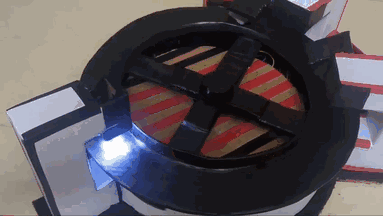
</p>

---

## 2. Problem Statement & Motivation

Manual package inspection and mechanical gate diversion in small-scale distribution facilities are labor-intensive, error-prone, and introduce significant latency. While large industrial distribution centers deploy high-speed machine vision systems and pneumatic ejectors, such solutions carry prohibitive financial and integration overhead for educational laboratories and small-scale operations.

This project addresses three fundamental engineering challenges:

1. **Optical Signal Stability in Varying Ambient Light:** Raw photodiode sensors are highly susceptible to ambient daylight fluctuations and 50/60 Hz AC fluorescent flicker. The system addresses this with an integrated optical gantry hood and on-board white LED illumination.
2. **Dynamic Reading vs. Mechanical Transport:** Taking color measurements while items are in motion often produces blurred or false intermediate readings. The system enforces a 3-reading debounce filter on consecutive non-base measurements before confirming package arrival.
3. **Coordinated Actuator Timing without Blocking Delays:** Operating a continuous drive motor, optical polling, and dual deflection servos on a single single-threaded 16 MHz microcontroller requires non-blocking timestamp scheduling (`millis()`) to prevent firmware lockup.

---

## 3. Key Engineering Features

<div align="center">

| Capability | Engineering Implementation | Technical Benefit |
|:---|:---|:---|
| **Rotary Carousel Geometry** | 360° annular turntable with central 4-blade rotor hub | Infinite test loop without belt dead-ends or manual reload |
| **Optical Frequency Conversion** | TCS3200 IC with 20% frequency scaling ($S_0=\text{HIGH}, S_1=\text{LOW}$) | Converts color intensity directly to digital square wave; immune to ADC noise |
| **Active Illumination Hood** | Downward-facing sensor mount inside dark gantry chamber with 4 LEDs | Normalizes incident lux and eliminates ambient shadow errors |
| **Dark Baseline Rejection** | Multi-channel baseline check (`BASE_TOLERANCE = 35%`) | Accurately identifies empty conveyor surface without false triggers |
| **Transient Debounce Logic** | 3 consecutive non-base reads required (`REQUIRED_PACKAGE_READINGS = 3`) | Suppresses conveyor surface imperfections and edge transitions |
| **Normalized Error Classifier** | Relative error minimization: $\epsilon = \frac{1}{3}\sum |x_c - \text{ref}_c| / \text{ref}_c$ | Scale-invariant color distance matching within 30% tolerance |
| **Non-Blocking FSM** | 4-state state machine evaluated via timestamp differentials | Ensures continuous sensor polling and zero CPU stalling |
| **Tri-Servo Actuation** | 1 continuous rotation drive servo + 2 synchronized SG90 micro servos | Positive package deflection with timed return and conveyor restart |
| **Real-Time Telemetry** | 9600 Baud Serial monitor diagnostic stream | Real-time R, G, B frequencies and state machine transition logging |

</div>

---

## 4. Hardware Architecture

The platform architecture integrates an electromechanical transport turntable, an optical acquisition station, and an electromechanical diversion assembly:

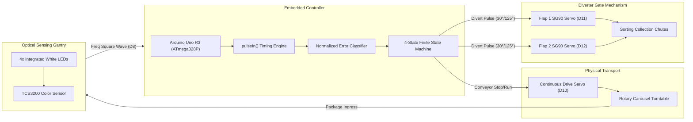

<p align="center">
  <a href="docs/architecture.md">
    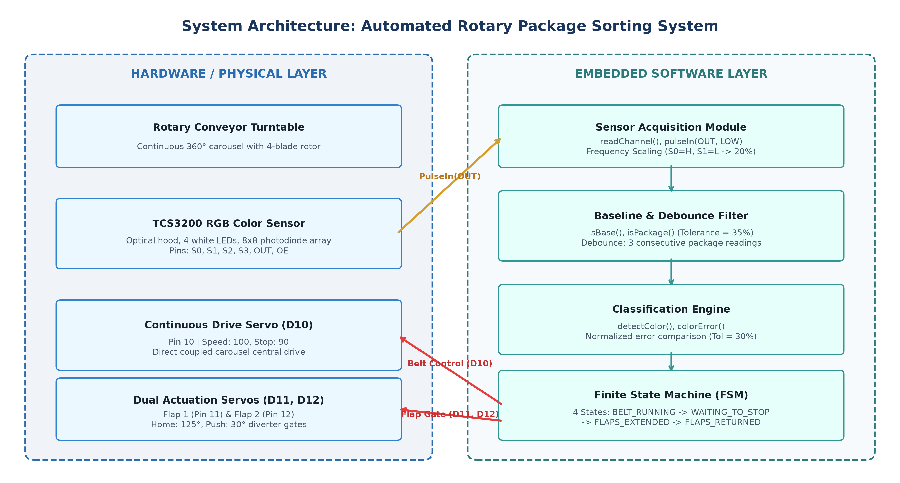
  </a>
  <br>
  <em>Figure 4.1: End-to-End System Architecture. Click image or visit <a href="docs/architecture.md">Architecture Specification</a> for detailed subsystem documentation.</em>
</p>

---

## 5. Operational Flowchart & FSM

The embedded control logic runs inside a deterministic, non-blocking 4-state Finite State Machine:

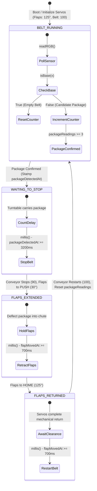

<p align="center">
  <a href="docs/assets/figure_6_1_fsm_state_transitions.png">
    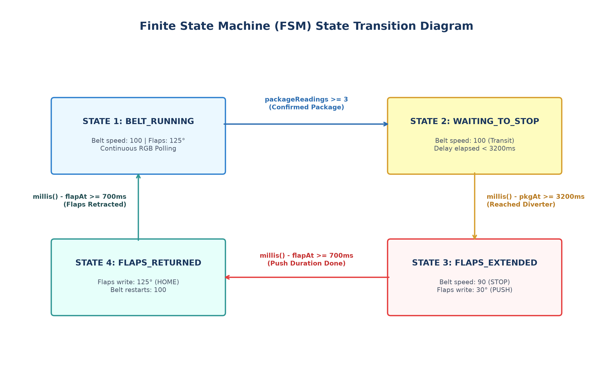
  </a>
  <br>
  <em>Figure 5.1: Finite State Machine (FSM) State Transition Matrix. See <a href="docs/architecture.md#5-finite-state-machine-fsm-specification">Architecture Section 5</a> for timing analysis.</em>
</p>

---

## 6. Component Catalog & Bill of Materials

All components listed below have been verified against the physical hardware implementation:

<div align="center">

| Component Name | Verified Hardware Model | Operational Function | Interface / Connection |
|:---|:---|:---|:---|
| **Microcontroller Board** | Arduino Uno R3 (ATmega328P) | Core processing unit, pulse timing, state control | 14 Digital I/O, 16 MHz, 5V TTL |
| **Optical Color Sensor** | TAOS / ams TCS3200 Breakout | RGB light-to-frequency conversion with 4 white LEDs | 6x GPIO lines (`S0`–`S3`, `OUT`, `OE`) |
| **Drive Actuator** | Continuous Rotation Servo Motor | Center-shaft rotary carousel turntable propulsion | PWM signal pin `D10` |
| **Diverter Gate Servos** | TowerPro SG90 9g Micro Servos (x2) | Angular actuation of sorting deflection flaps | PWM signal pins `D11` and `D12` |
| **Rotary Conveyor Frame** | Custom Annular Turntable | Closed-loop 360° circular package transit ring | 4-blade rotor coupled to drive servo |
| **Optical Gantry Bridge** | Custom Cardboard Baffled Gantry | Fixed optical clearance & light-tight sensor shroud | Straddles conveyor track |
| **Sorting Chutes** | Custom Cardboard Dual Bins | Directs and stores deflected packages by category | Positioned at $5^\circ$ and $30^\circ$ exit angles |
| **Host Workstation** | Windows PC running Arduino IDE | Firmware compilation, flashing, and serial telemetry | USB-A to USB-B serial link (9600 Baud) |

</div>

---

## 7. Wiring & Pin Interconnections

<p align="center">
  <a href="docs/wiring.md">
    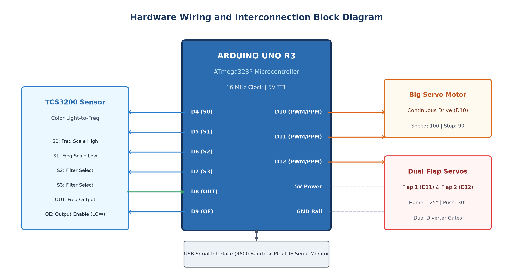
  </a>
</p>

The hardware interconnection is wired according to the pin configuration defined in [`src/conveyor_color_sorting/conveyor_color_sorting.ino`](src/conveyor_color_sorting/conveyor_color_sorting.ino):

<div align="center">

| Module | Module Pin | Arduino Uno Pin | Signal Direction | Functional Description |
|:---|:---:|:---:|:---:|:---|
| **TCS3200** | `S0` | **D4** | Arduino $\to$ Sensor | Output frequency scaling bit 0 (`HIGH` = 20% scale) |
| **TCS3200** | `S1` | **D5** | Arduino $\to$ Sensor | Output frequency scaling bit 1 (`LOW` = 20% scale) |
| **TCS3200** | `S2` | **D6** | Arduino $\to$ Sensor | Photodiode color filter selector bit 0 |
| **TCS3200** | `S3` | **D7** | Arduino $\to$ Sensor | Photodiode color filter selector bit 1 |
| **TCS3200** | `OUT` | **D8** | Sensor $\to$ Arduino | Frequency square-wave output (read via `pulseIn()`) |
| **TCS3200** | `OE` | **D9** | Arduino $\to$ Sensor | Output Enable (Active `LOW`, driven permanently low) |
| **TCS3200** | `VCC` | **5V** | Power Rail | Regulated +5V DC power for IC and 4 white LEDs |
| **TCS3200** | `GND` | **GND** | Ground Rail | Common reference ground |
| **Drive Servo** | `PWM` (Orange) | **D10** | Arduino $\to$ Motor | Continuous carousel drive command (`100` = Run, `90` = Stop) |
| **Flap 1 (SG90)** | `PWM` (Orange) | **D11** | Arduino $\to$ Motor | Diverter gate 1 angular position (`125°` = Home, `30°` = Push) |
| **Flap 2 (SG90)** | `PWM` (Orange) | **D12** | Arduino $\to$ Motor | Diverter gate 2 angular position (`125°` = Home, `30°` = Push) |

</div>

> [!TIP]
> **Power Isolation Best Practice:**
> For benchtop operation, power the three servos from an external regulated 5V (2A+) DC supply with grounds tied to Arduino `GND`. See [Complete Electrical Specification](docs/wiring.md) for current budget and schematic details.

---

## 8. Embedded Firmware Architecture

The firmware is implemented as a single, modular, highly readable Arduino C++ sketch in [`src/conveyor_color_sorting/conveyor_color_sorting.ino`](src/conveyor_color_sorting/conveyor_color_sorting.ino).

### Sensor Channel Acquisition
The function `readChannel(s2, s3)` sets the photodiode filter pins, allows a 50 ms optical settlement delay, and captures the pulse width via `pulseIn()`:

```cpp
unsigned long readChannel(bool s2, bool s3) {
  digitalWrite(S2, s2);
  digitalWrite(S3, s3);
  delay(50);

  unsigned long pulse = pulseIn(OUT, LOW, 100000);
  if (pulse == 0) return 0;
  return 1000000UL / pulse; // Convert half-period to frequency (Hz)
}
```

### Composite RGB Acquisition
The `readRGB()` routine sequentially samples Red, Blue, and Green channels into a structured record:

```cpp
struct RGB {
  unsigned long r;
  unsigned long g;
  unsigned long b;
};

RGB readRGB() {
  RGB x;
  x.r = readChannel(LOW, LOW);   // Red filter
  x.b = readChannel(LOW, HIGH);  // Blue filter
  x.g = readChannel(HIGH, HIGH); // Green filter
  return x;
}
```

---

## 9. Mathematical Color Classification Model

The classifier evaluates raw pulse frequencies against empirical reference centroids established during calibration:

### 1. Calibrated Reference Constants
* **Empty Belt Baseline:** $R = 4432\text{ Hz}, G = 3693\text{ Hz}, B = 4541\text{ Hz}$ (`BASE_TOLERANCE = 35%`)
* **White Package Centroid:** $R = 15531\text{ Hz}, G = 18231\text{ Hz}, B = 19863\text{ Hz}$
* **Brown Package Centroid:** $R = 19070\text{ Hz}, G = 13023\text{ Hz}, B = 13031\text{ Hz}$
* **Color Tolerance Window:** `COLOR_TOLERANCE = 0.30` (30%)

### 2. Relative Error Formulation
To prevent channel magnitude bias (e.g., Red values overpowering Blue values), each channel is normalized by its reference:

$$\epsilon_R = \frac{|x_r - \text{Ref}_r|}{\text{Ref}_r}, \quad \epsilon_G = \frac{|x_g - \text{Ref}_g|}{\text{Ref}_g}, \quad \epsilon_B = \frac{|x_b - \text{Ref}_b|}{\text{Ref}_b}$$

$$\text{colorError}(x, \text{Ref}) = \frac{\epsilon_R + \epsilon_G + \epsilon_B}{3.0}$$

```cpp
float colorError(RGB x, float refR, float refG, float refB) {
  float errorR = abs((long)x.r - (long)refR) / refR;
  float errorG = abs((long)x.g - (long)refG) / refG;
  float errorB = abs((long)x.b - (long)refB) / refB;
  return (errorR + errorG + errorB) / 3.0;
}
```

### 3. Classification Decision Rule
1. If `isBase(x)` evaluates true, classify as `"BASE"`.
2. Compute `whiteError` and `brownError`.
3. If `whiteError <= brownError` and `whiteError <= 0.30` $\to$ `"WHITE"`.
4. If `brownError < whiteError` and `brownError <= 0.30` $\to$ `"BROWN"`.
5. Fallback $\to$ `"WHITE"`.

---

## 10. System Requirements

### Hardware Requirements
* **Microcontroller:** Arduino Uno R3 (ATmega328P @ 16 MHz)
* **Optical Sensor:** TCS3200 / TCS230 color sensor breakout
* **Actuation:** 1x continuous rotation servo + 2x TowerPro SG90 micro servos
* **Power Supply:** 5V DC 2A regulated power source or powered USB hub
* **Interconnect:** 8-pin female-to-male jumper harness + male-to-male jumpers

### Software & Toolchain Requirements
* **IDE:** Arduino IDE 1.8.x or 2.x
* **Libraries:** Standard `<Servo.h>` (pre-bundled with Arduino AVR core)
* **Operating System:** Cross-platform (Windows 10/11, macOS, Ubuntu Linux)

---

## 11. Installation & Build Guide

```bash
# 1. Clone the repository
git clone https://github.com/AakarGupta-coder/Automated-Conveyor-Based-Color-Sorting-System.git
cd Automated-Conveyor-Based-Color-Sorting-System

# 2. Open sketch in Arduino IDE
# Navigate to: src/conveyor_color_sorting/conveyor_color_sorting.ino
```

### Arduino IDE Upload Instructions:
1. Connect the Arduino Uno to your workstation via USB.
2. Under **Tools > Board**, select **Arduino Uno**.
3. Under **Tools > Port**, select the corresponding serial port (e.g., `COM3` on Windows or `/dev/ttyUSB0` on Linux).
4. Click **Verify** (`Ctrl + R`) to compile the sketch.
5. Click **Upload** (`Ctrl + U`) to flash the firmware.
6. Open the **Serial Monitor** (`Ctrl + Shift + M`) and configure the baud rate to **9600 baud**.

For in-depth operational checklists, refer to the [Operation Guide](docs/operation.md).

---

## 12. Calibration & Tuning Guide

<p align="center">
  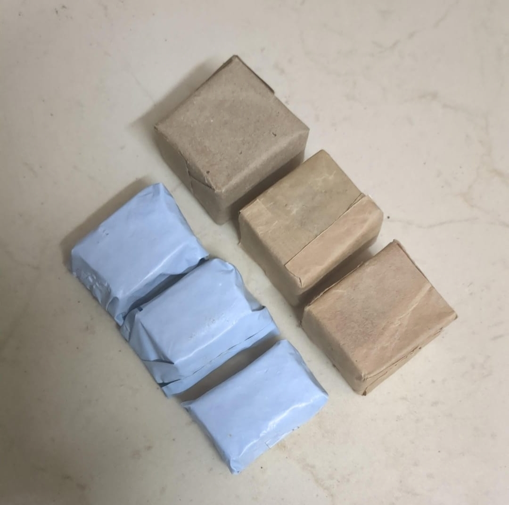
</p>

1. **Belt Baseline Calibration:** Run the conveyor without packages. Note the `R`, `G`, `B` frequency values reported on the Serial Monitor. Update `BASE_R`, `BASE_G`, `BASE_B` in lines 30–32 if belt lighting changes.
2. **Package Spectral Centroids:** Place a white package under the optical hood and log the frequency averages. Repeat for the brown cardboard package. Update `WHITE_R..B` and `BROWN_R..B` (lines 39–46).
3. **Conveyor Transit Delay (`STOP_DELAY`):** Adjust line 23 (`STOP_DELAY = 3200;`) to match the exact physical transit time from the optical hood to the diversion gate.
4. **Flap Sweep Angles:** Calibrate `FLAP_HOME = 125;` and `FLAP_PUSH = 30;` to ensure positive package deflection into the sorting chute without binding against the carousel rim.

---

## 13. Visual Demonstration Gallery

<div align="center">

### Complete Prototype Assembly
<p align="center">
  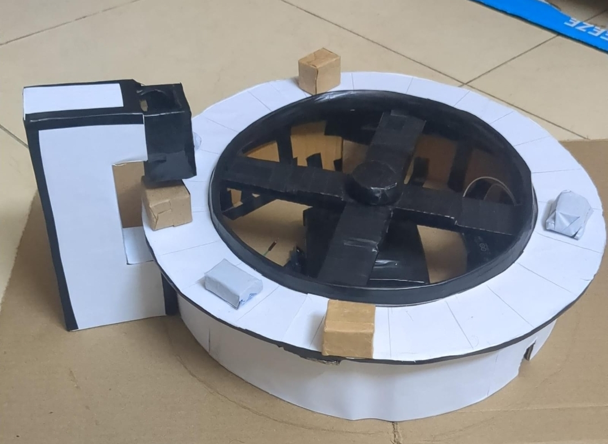
  <br>
  <em>Overview of the assembled 360° rotary conveyor prototype with optical sensor gantry and package specimens.</em>
</p>

### Sensor Subsystem & Optical Hood
<p align="center">
  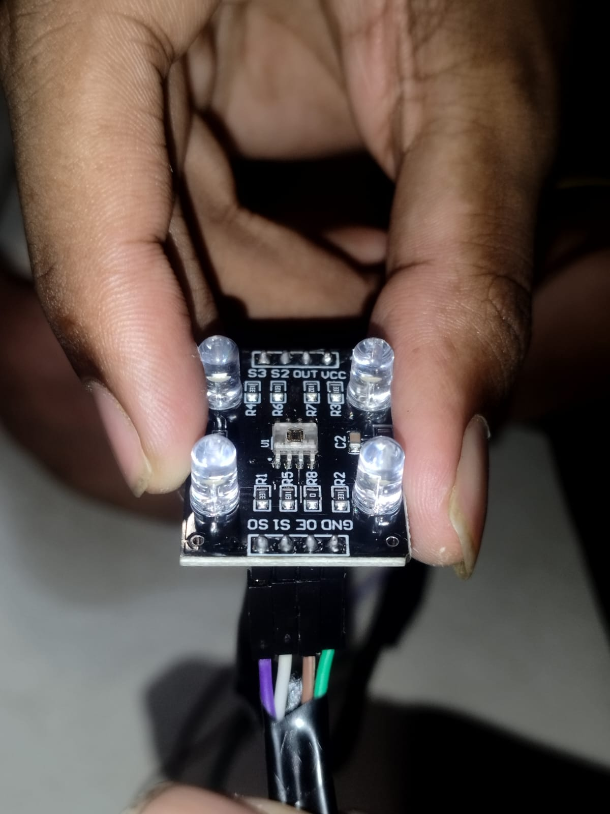
  &nbsp;&nbsp;
  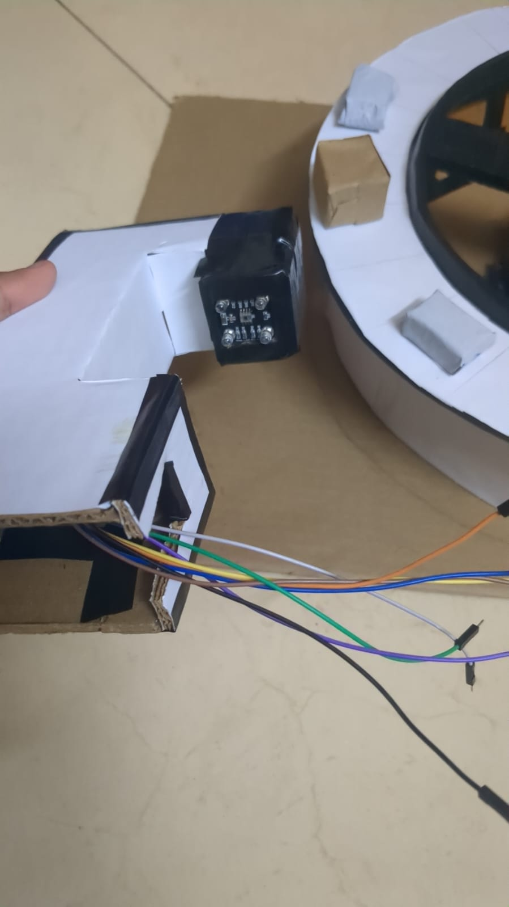
  <br>
  <em>Left: TCS3200 breakout module with 4 white LEDs. Right: Sensor mounted facing downwards within optical hood with gantry wire routing.</em>
</p>

### Diverter Gate Mechanism & Collection Chutes
<p align="center">
  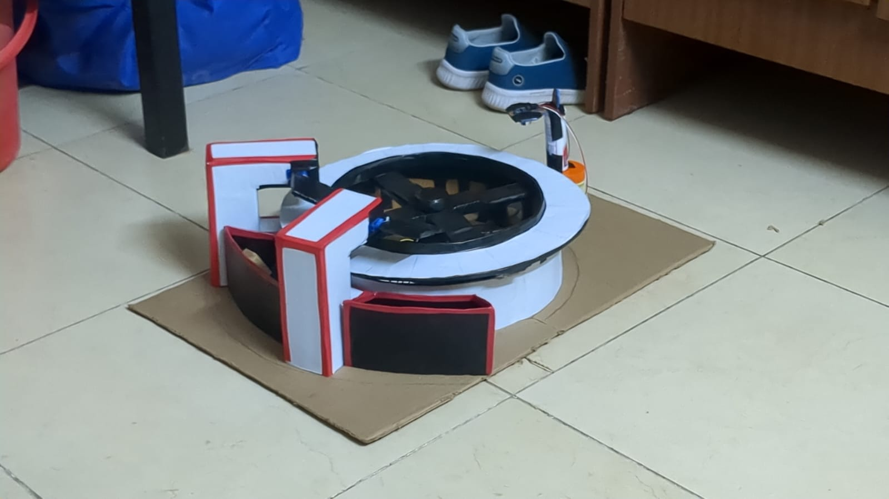
  &nbsp;&nbsp;
  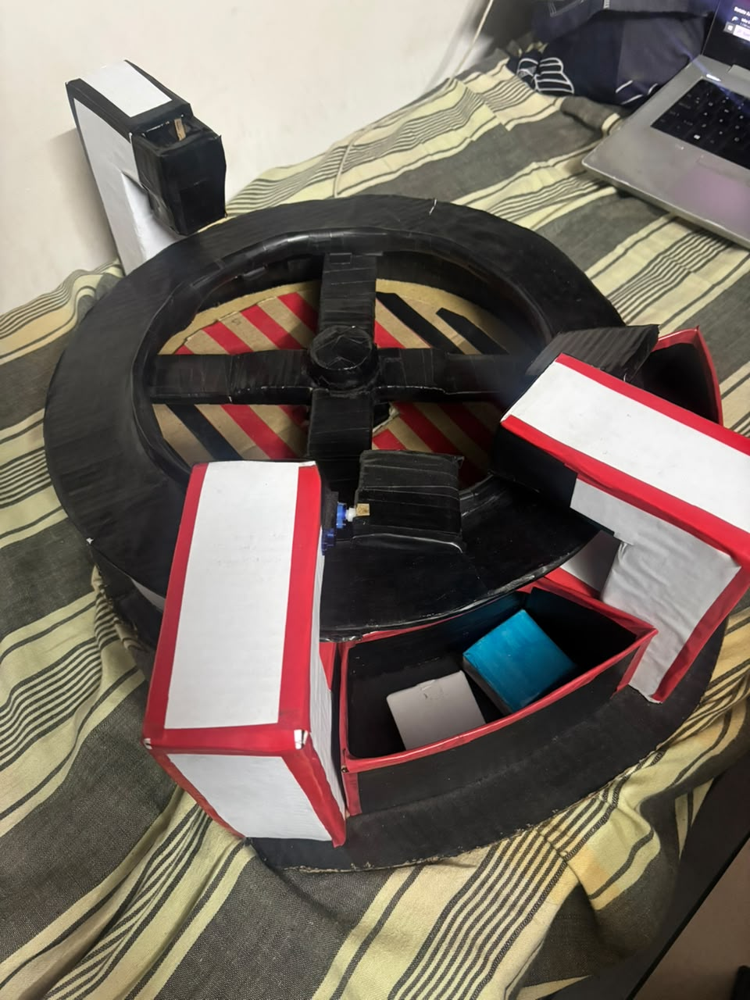
  <br>
  <em>Left: Dual diverter towers with mechanical flaps and collection chutes. Right: Deflected packages resting inside the sorting bin.</em>
</p>

### Overhead Geometric Layout
<p align="center">
  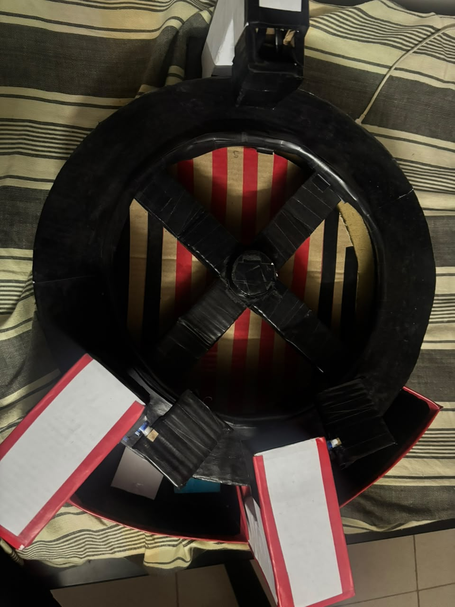
  &nbsp;&nbsp;
  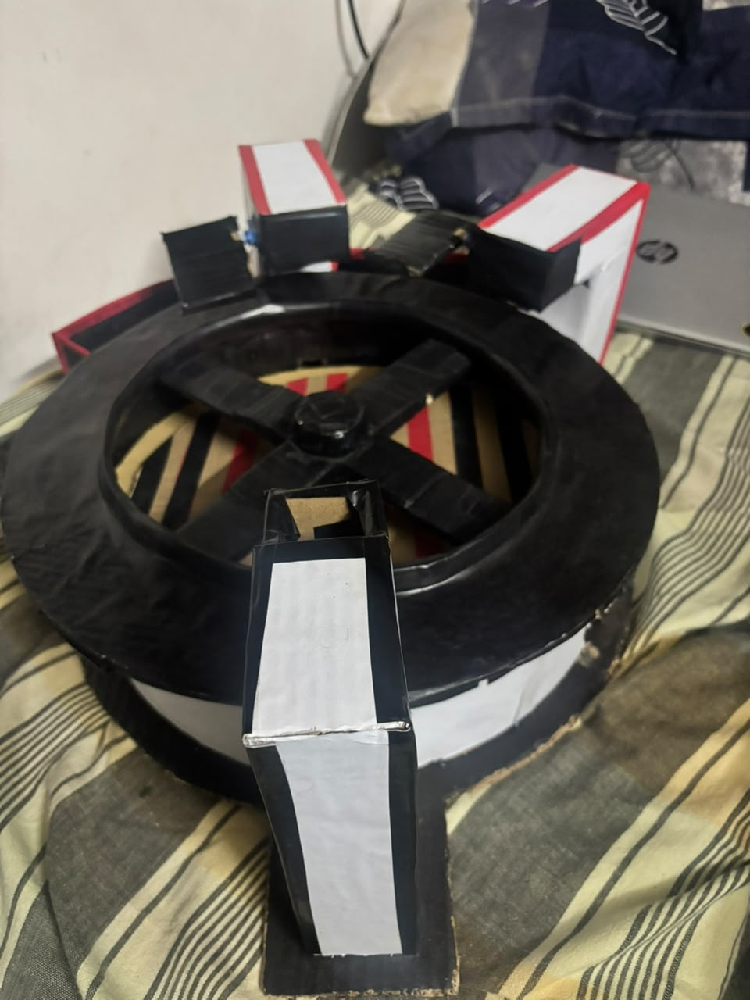
  <br>
  <em>Left: Concentric 360° carousel plan view showing gantry at 12 o'clock and diverters at 5 and 7 o'clock. Right: Top-down view of SG90 diverter servos.</em>
</p>

</div>

---

## 14. Video Demonstrations & Operational Timelines

Two authentic video recordings document the physical sorting system across single-item and multi-item operational scenarios:

### Demonstration 1: Single-Cycle Rapid Test (`test1.mp4`)

* **Video File:** [`media/videos/test1.mp4`](media/videos/test1.mp4) (5.78 MB, 34.93s, 848x478 @ 30 fps)
* **High-Speed Actuation Sequence:** Documented in [Media Index](docs/media.md#31-single-cycle-keyframes-test1mp4)

```text
00:00 - 00:08 | Carousel rotating. Operator introduces test package onto belt.
00:08 - 00:15 | Package enters optical gantry. TCS3200 illuminates package under hood.
00:15 - 00:18 | 3 consecutive non-base reads confirm package. Color classified ('WHITE').
00:18 - 00:22 | Transit delay (3200 ms). Turntable transports package to diverter gates.
00:22 - 00:25 | Conveyor stops (speed 90). Dual flaps actuate to 30°, deflecting package into chute.
00:25 - 00:28 | Flaps hold for 700 ms, then retract to home (125°).
00:28 - 00:34 | Turntable restarts (speed 100). System resets, ready for next item.
```

### Demonstration 2: Full Continuous Multi-Package Demonstration (`24BRS1321,1034 Project Video.mp4`)

* **Video File:** `media/videos/24BRS1321,1034 Project Video.mp4` (178 MB, 72.60s, 1920x1080 @ 30 fps Full HD)
* **Cloud Mirror Link:** [Google Drive Full-HD Demonstration Video Link Placeholder]
* **Full Chronological Breakdown:** Documented in [Media Index](docs/media.md#22-video-demonstration-2-full-continuous-multi-package-demonstration-24brs13211034-project-videomp4)
* **Spoken Audio Transcript:** Documented in [Video Transcript](docs/video_transcript.md) (provides verbatim voice narration of warehouse inventory sorting logic)

```text
00:00 - 00:20 | Stationary turntable overview; USB host cable connected to power Arduino Uno.
00:20 - 00:26 | System boot: TCS3200 white LEDs light up under gantry; carousel turntable starts rotating.
00:26 - 00:40 | Cycle 1: Brown Box #1 enters sensor, classified as Brown, transit timer elapses, deflected into Left Chute.
00:40 - 00:53 | Cycle 2: Blue Box ("ALL ON") transits under sensor, classified as Blue, deflected into Right Chute.
00:53 - 01:04 | Cycle 3: White Parcel transits under sensor, classified as White, deflected into Right Chute.
01:04 - 01:12 | Cycle 4: Brown Box #2 transits under sensor, classified as Brown, deflected into Left Chute.
01:12 | Verification Complete: 4 parcels successfully sorted across dual chutes (100% accuracy).
```

---

## 15. Empirical Testing & Validation

System validation was performed by testing repeated runs of **White parcels** and **Brown kraft cardboard packages**:

<div align="center">

| Test Category | Target Specimen | Measured Frequency Profile (Hz) | Classifier Output | Mechanical Diversion Outcome |
|:---|:---|:---|:---:|:---:|
| **Baseline Test** | Empty Carousel Belt | $R \approx 4430, G \approx 3690, B \approx 4540$ | `BASE` | Conveyor continues; no actuation |
| **Category 1** | White Wrapped Parcel | $R \approx 15500, G \approx 18200, B \approx 19800$ | `WHITE` | Successfully diverted into Chute 1 |
| **Category 2** | Brown Kraft Box | $R \approx 19000, G \approx 13000, B \approx 13000$ | `BROWN` | Successfully diverted into Chute 2 |
| **Debounce Test** | Rapid edge transition | Single-cycle deviation ($N < 3$) | Ignored | False positive rejected |

</div>

---

## 16. Known Limitations

* **Ambient Light Sensitivity:** Although the optical hood shields against direct glare, extreme shifts in ambient illuminance (e.g., direct sunlight) can shift baseline frequencies.
* **Open-Loop Transit Timing:** The 3200 ms transit delay assumes constant belt velocity. Variations in mechanical friction or motor supply voltage can cause minor positional drift.
* **Surface Texture Dependence:** Highly specular or glossy package surfaces can cause localized reflection spikes compared to matte kraft paper.
* **Fixed Color Repertoire:** The firmware is pre-calibrated specifically for white parcels, brown boxes, and the dark belt baseline.

---

## 17. Project Roadmap & Future Work

- [x] Annular rotary carousel design and continuous servo drive.
- [x] TCS3200 color sensing with 20% frequency scaling.
- [x] Baseline rejection filter and 3-sample debounce logic.
- [x] Non-blocking 4-state Finite State Machine.
- [x] Dual SG90 micro-servo diverter gates and sorting chutes.
- [ ] Add photoelectric / IR beam-break sensors at diverter gates for closed-loop position verification.
- [ ] Implement EEPROM-based interactive runtime color calibration via Serial CLI.
- [ ] Expand classification matrix to support additional package categories (e.g., Blue, Red, Yellow).
- [ ] Add an I2C 16x2 LCD or OLED display for standalone sorting telemetry.

---

## 18. Repository Directory Structure

```text
Automated-Conveyor-Based-Color-Sorting-System/
├── .gitignore                               # Git ignore exclusions
├── LICENSE                                  # Open-source MIT License
├── README.md                                # Master project documentation
│
├── src/                                     # Firmware source code
│   └── conveyor_color_sorting/
│       └── conveyor_color_sorting.ino       # Main Arduino control sketch
│
├── docs/                                    # Technical documentation hub
│   ├── architecture.md                      # System architecture & FSM specification
│   ├── wiring.md                            # Hardware wiring & electrical specifications
│   ├── operation.md                         # Build, upload, and calibration instructions
│   ├── media.md                             # Photographic & video demonstration index
│   ├── video_transcript.md                  # Verbatim voice narration transcript
│   └── assets/                              # High-resolution architectural figures
│       ├── sortbot_logo.png                 # SORTBOT project banner logo
│       ├── figure_4_1_hardware_wiring.png   # Wiring interconnection block diagram
│       ├── figure_5_1_system_architecture.png # End-to-end system architecture
│       ├── figure_5_2_use_case_diagram.png  # UML use case diagram
│       ├── figure_5_3_class_data_model.png  # Procedural data model
│       ├── figure_5_4a_sequence_diagram.png # UML sequence diagram
│       ├── figure_5_4b_activity_flowchart.png # Operational activity flowchart
│       ├── figure_6_1_fsm_state_transitions.png # FSM state transition matrix
│       └── conveyor_sorting_demo.gif        # Optimized animated demonstration
│
└── media/                                   # Authentic project media
    ├── images/                              # Descriptively named hardware photographs
    │   ├── prototype_overview.jpg           # Assembled prototype overview
    │   ├── test_packages_white_brown.jpg    # Calibrated test specimens
    │   ├── tcs3200_sensor_module.jpg        # TCS3200 breakout module
    │   ├── carousel_package_ingress.jpg     # Package entering optical hood
    │   ├── sensor_mounting_underside.jpg    # Downward-facing sensor mounting
    │   ├── dual_flap_sorting_mechanism.jpg  # Diverter gates and collection chutes
    │   ├── servo_actuation_topview.jpg      # Top-down view of SG90 actuators
    │   ├── carousel_zenith_planview.jpg     # Concentric 360° carousel plan view
    │   ├── sorted_packages_collection_bin.jpg # Deflected packages in sorting chute
    │   └── originals/                       # Archived original captures (1.jpeg - 10.jpeg)
    ├── frames/                              # High-speed actuation frame extraction
    │   ├── actuation_18s.jpg .. 28s.jpg     # Video 1 deflection sequence keyframes
    │   ├── video2_01s.jpg .. 08s.jpg        # Video 2 multi-package sequence keyframes
    │   └── frame_01s.jpg .. 34s.jpg         # Continuous operation sequence
    └── videos/                              # Demonstration recordings
        ├── test1.mp4                        # Single-cycle rapid verification video (5.78 MB)
        ├── 24BRS1321,1034 Project Video.mp4 # Full-HD multi-package demonstration (178 MB, Google Drive)
        └── README.md                        # Video index & playback notes
```

---

## 19. Troubleshooting Guide

<div align="center">

| Symptom | Probable Root Cause | Recommended Diagnostic Procedure |
|:---|:---|:---|
| **`INVALID SENSOR READING` on Serial Monitor** | `pulseIn()` timing out on `OUT` pin (D8) | Check D8 connection, verify sensor `OE` pin is tied to D9 (driven `LOW`), confirm 5V power to TCS3200. |
| **All readings classify as `BASE`** | Background threshold too wide or package color too close to belt | Check `BASE_TOLERANCE` (default 0.35); place specimen under hood and compare against `BASE_R..B`. |
| **Conveyor belt does not rotate** | Big servo power disconnected or calibration offset | Confirm D10 signal connection; check if servo requires `SERVO_SPEED` adjustment around 90–110. |
| **Flaps do not actuate or jitter violently** | Insufficient servo current supply or floating ground | Power servos from external 5V supply; ensure common ground bridge between Arduino and external supply. |
| **Package overshoots diverter gate** | Transit delay (`STOP_DELAY`) too long | Decrease `STOP_DELAY` (e.g., from 3200 ms to 3000 ms) in `conveyor_color_sorting.ino`. |
| **Arduino resets when flaps move** | Voltage brownout due to motor inrush current | Do not draw servo operating power from Arduino 5V regulator pin; use dedicated 5V 2A external rail. |

</div>

---

## 20. Author & Credits

This project was conceived, designed, fabricated, and validated as an embedded systems and hardware automation engineering project.

### Project Author
* **Aakar Gupta** — *System Architecture, Firmware Design, Mechanical Assembly, and Validation*

---

## 21. License

This project is released under the open-source [MIT License](LICENSE). You are free to inspect, modify, and distribute the hardware designs and software implementations for academic and commercial applications with proper attribution.

---

## 22. References & Technical Datasheets

* Microchip ATmega328P 8-bit AVR Microcontroller Datasheet: [Microchip Technology](https://www.microchip.com/en-us/product/ATmega328P)
* TAOS / ams TCS3200 Programmable Color Light-to-Frequency Converter Datasheet: [TAOS TCS3200 Documentation](https://www.mouser.com/datasheet/2/588/TCS3200-DB-10842.pdf)
* TowerPro SG90 9g Sub-Micro Servo Technical Specifications: [TowerPro SG90 Manual](https://components101.com/motors/micro-servo-motor)
* Arduino AVR Core Servo Library Reference: [Arduino Servo Documentation](https://www.arduino.cc/reference/en/libraries/servo/)
