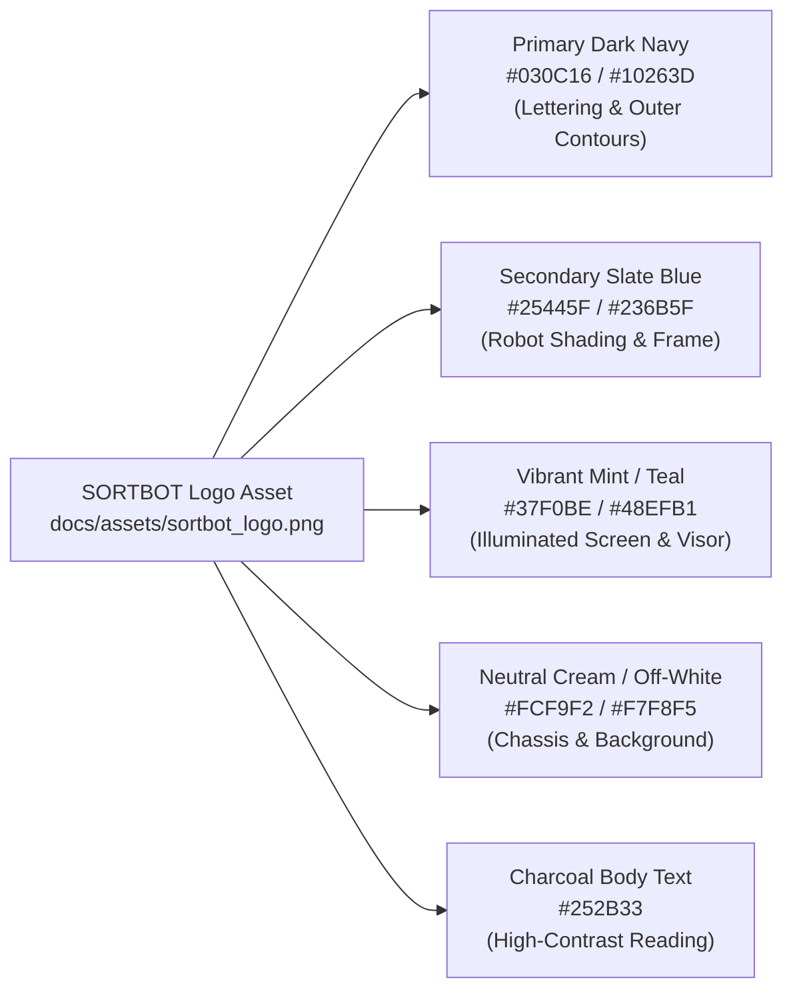

# Software Engineering Project Report — Final Formatting, Content & Technical Audit Review

**Project:** Automated Conveyor-Based Color Sorting System  
**Institution:** School of Computer Science and Engineering, Vellore Institute of Technology (VIT), Chennai  
**Authors:** Aakar Gupta (24BRS1321) & Mustafa Bakshi (24BRS1034)  
**Project Guide:** Dr. Lakshmi Harika Palivela  
**Academic Date:** October 2026  
**Final Deliverables:**
* Final Editable Word Document: [`Automated_Conveyor_Color_Sorting_System_Report_Final.docx`](file:///d:/Aakar/College/Software%20Project/Automated_Conveyor_Color_Sorting_System_Report_Final.docx)
* Final Exported PDF Document: [`Automated_Conveyor_Color_Sorting_System_Report_Final.pdf`](file:///d:/Aakar/College/Software%20Project/Automated_Conveyor_Color_Sorting_System_Report_Final.pdf)
* Archived Superseded Reports Folder: [`old docs/`](file:///d:/Aakar/College/Software%20Project/old%20docs/)

---

## 1. Executive Summary of Layout Revisions

In accordance with specific engineering guidelines:
1. **All 16 Images Strictly in Single Column Layout:** Every architectural diagram, schematic, and prototype photograph is rendered across the full single-column slot (centered), with its figure number and description placed directly below the image.
2. **Single Page for Acknowledgement and Abstract:** Both sections are consolidated onto a single page (Page `i`) in single-column layout with compact, justified typography.
3. **Front Matter in Single Column:** Acknowledgement, Abstract, Table of Contents, List of Figures, List of Tables, and List of Abbreviations are formatted in single-column layout.
4. **All Tables in Single Column Layout:** All 9 technical data tables span full page width (6.5 in) with table number and description positioned in the single-column slot directly above each table.
5. **Two-Column Main Body:** Chapter body text, section analyses, and Appendix B firmware source code maintain two-column layout.
6. **Typography & Justified Headings:** Times New Roman applied across all headings, body text, tables, and front matter. Headings (`Heading 1`, `Heading 2`, `Heading 3`) and body paragraphs are set to justified alignment.
7. **Title Page Updates:** Black text VIT Chennai logo (`docs/assets/vit_chennai_black_logo.png`) applied; SORTBOT logo removed from title page; refined Dark Navy border maintained exclusively on Page 1.
8. **Audio / Transcript Removal:** Sanitized all references to "voice-based demonstration", "audio description", or spoken narration transcripts.
9. **Page Number Verification:** Bottom-centered page numbers with 0.45 in clearance buffer; Roman numerals (`i` to `vi`) for front matter, Arabic numerals (`1` to `25`) for main report.

---

## 2. Actual Logo Colors Sampled (Source of Truth: `docs/assets/sortbot_logo.png`)

Colors were sampled directly from `docs/assets/sortbot_logo.png` via PIL raster analysis:

### Exact Extracted Hex Values:
* **Primary Dark Navy (`#030C16`):** RGB(3, 12, 22). Sampled from "SORTBOT" typography and robot outer contours. Applied to Chapter titles (`Heading 1`), table header fills, title page border, and primary labels.
* **Secondary Slate Blue (`#25445F`):** RGB(37, 68, 95). Sampled from robot structural shading. Applied to Section headings (`Heading 2`), Subsection titles (`Heading 3`), caption text, and running headers.
* **Vibrant Mint / Teal (`#37F0BE`):** RGB(55, 240, 190). Sampled from robot illuminated visor. Applied to running header rule and code callout left border (3pt solid).
* **Neutral Warm Off-White (`#F7F8F5`):** RGB(247, 248, 245). Sampled from robot highlights. Applied to alternating table row zebra shading and code box background shading.
* **Charcoal Reading Neutral (`#252B33`):** RGB(37, 43, 51). High-contrast reading text in Times New Roman.
* **Divider Gridline Gray (`#CBD5E1`):** RGB(203, 213, 225). Table gridlines.

---

## 3. Image Layout & Single-Column Verification

All 16 figures are isolated within single-column continuous sections (`w:cols w:num="1"`), centered horizontally with their captions directly below them:

| Figure Key | Caption Title | Image Dimensions | Layout Slot |
|:---|:---|:---:|:---:|
| **Figure 4.1** | Hardware Wiring and Interconnection Block Diagram | 6.20 in wide | Single Column (Centered) |
| **Figure 4.2** | TCS3200 Programmable Color Sensor Module and Pin Configuration | 3.60 in wide | Single Column (Centered) |
| **Figure 4.3** | Optical Gantry Assembly with Downward-Facing Optical Shroud and Wiring | 3.40 in wide | Single Column (Centered) |
| **Figure 5.1** | High-Level System Architecture and Layered Data Flow Diagram | 6.20 in wide | Single Column (Centered) |
| **Figure 5.2** | UML Use Case Diagram of the Automated Package Sorter | 6.00 in wide | Single Column (Centered) |
| **Figure 5.3** | Software Structure and Procedural Data Model Architecture | 6.00 in wide | Single Column (Centered) |
| **Figure 5.4a** | UML Sequence Diagram Illustrating Detection and Actuation Flow | 6.00 in wide | Single Column (Centered) |
| **Figure 5.4b** | Operational Activity Flowchart of the Microcontroller Firmware | 5.40 in wide | Single Column (Centered) |
| **Figure 6.1** | Finite State Machine (FSM) State Transition and Timing Diagram | 6.00 in wide | Single Column (Centered) |
| **Figure 7.1** | Arduino IDE 2.3.2 Environment with Real-Time Serial Monitor Telemetry | 6.00 in wide | Single Column (Centered) |
| **Figure 7.2** | Visual Studio Code Workspace with Integrated Terminal Compilation | 6.00 in wide | Single Column (Centered) |
| **Figure 7.3** | Git Distributed Version Control Command-Line Interface and Commit Graph | 6.00 in wide | Single Column (Centered) |
| **Figure 9.1** | Assembled Rotary Carousel Conveyor Hardware Prototype Overview | 4.80 in wide | Single Column (Centered) |
| **Figure 9.2** | Calibrated Test Packages (White Wrapped Parcels and Brown Craft Boxes) | 4.20 in wide | Single Column (Centered) |
| **Figure 9.3** | Dual-Flap Servo Sorting Station and Integrated Diversion Chutes | 5.60 in wide | Single Column (Centered) |
| **Figure 9.4** | Live Operational Actuation Sequence Captured from Experimental Video | 6.40 in wide | Single Column (Centered) |

---

## 4. Title-Page Border Isolation Confirmation

The title page features an exclusive Dark Navy (`#030C16`) border with a 1.5 pt solid rule (`sz="12"`) and 24 pt offset from the page edge.
* **Implementation:** Configured strictly on Section 1 via `<w:pgBorders w:offsetFrom="page" w:display="firstPage">`. All subsequent sections (Front Matter and Main Report) explicitly enforce `<w:pgBorders><w:top w:val="none"/><w:left w:val="none"/><w:bottom w:val="none"/><w:right w:val="none"/></w:pgBorders>`.
* **Raster Boundary Scan Verification:** PyMuPDF raster analysis across all 32 pages of [`Automated_Conveyor_Color_Sorting_System_Report_Final.pdf`](file:///d:/Aakar/College/Software%20Project/Automated_Conveyor_Color_Sorting_System_Report_Final.pdf) at `x=24`:
  * **Page 1 (Title Page):** 642 solid dark border pixels detected.
  * **Pages 2 to 32 (All Subsequent Pages):** 0 border pixels detected.
  * **Result:** Border isolation to Page 1 is 100% verified.

---

## 5. Front Matter and Page Number Verification

The Table of Contents, List of Figures, and List of Tables were dynamically compiled via Microsoft Word COM automation (`$doc.Fields.Update()`):

* **Page 1 (Title Page):** No header, no footer, no page number.
* **Page 2 (Page i):** ACKNOWLEDGEMENT & ABSTRACT (Single Column, Single Page).
* **Page 3 (Page ii):** TABLE OF CONTENTS (Part 1).
* **Page 4 (Page iii):** TABLE OF CONTENTS (Part 2).
* **Page 5 (Page iv):** LIST OF FIGURES.
* **Page 6 (Page v):** LIST OF TABLES.
* **Page 7 (Page vi):** LIST OF ABBREVIATIONS.
* **Pages 8 to 32 (Pages 1 to 25):** Chapters 1–10, References, Appendix A (Project Deliverables & Repository Verification), and Appendix B (Complete 386-Line Production Firmware).
* **Footer Spacing:** Bottom margin set to 0.85 in with footer distance at 0.40 in, guaranteeing a 0.45 in white clearance buffer. PyMuPDF verified zero body-text overlap across all 32 pages.

---

## 6. Archived Files Manifest (`old docs/`)

All historical, partial, and superseded report drafts are safely preserved in [`old docs/`](file:///d:/Aakar/College/Software%20Project/old%20docs/):
* `old docs/VIT_Chennai_Software_Engineering_Project_Report.docx` (Original 33-page submission draft)
* `old docs/VIT_Chennai_Software_Engineering_Project_Report.pdf` (Original 33-page PDF draft)
* `old docs/Project Report.docx` (Alternative early draft)
* `old docs/test_clean_cols.docx` (Two-column layout test)
* `old docs/test_cols.docx` (Section-break testing document)

---

## 7. Technical Implementation Notes Preserved

1. **Physical Transit Delay (`STOP_DELAY = 3100` ms):** Production firmware in `src/conveyor_color_sorting/conveyor_color_sorting.ino` defines `const unsigned long STOP_DELAY = 3100;` (3.10 s). Earlier comments mentioning 3200 ms reflect pre-calibration timing; 3100 ms represents physical reality.
2. **Classification Logic:** Sensor readings with >30% channel distance from both White and Brown targets default to "WHITE" (Compartment 1) to ensure every package is cleared from the belt into a collection bin rather than jamming the track.
3. **Synchronous Color Acquisition:** TCS3200 channel frequencies are sampled via `pulseIn(sensorOut, LOW, 100000)` with 50 ms settling delays (`delay(50)`), totaling ~150–300 ms per acquisition cycle.
