# Software Engineering Project Report — Formatting, Content & Technical Audit Review

**Project Title:** Automated Conveyor-Based Color Sorting System  
**Institution:** School of Computer Science and Engineering, Vellore Institute of Technology (VIT), Chennai  
**Authors:** Aakar Gupta (24BRS1321) & Mustafa Bakshi (24BRS1034)  
**Project Guide:** Dr. Lakshmi Harika Palivela  
**Academic Date:** October 2026  
**Deliverable Artifacts:**
* Redesigned Editable Document: [`Automated_Conveyor_Color_Sorting_System_Report_Final.docx`](file:///d:/Aakar/College/Software%20Project/Automated_Conveyor_Color_Sorting_System_Report_Final.docx)
* Final Exported Academic PDF: [`Automated_Conveyor_Color_Sorting_System_Report_Final.pdf`](file:///d:/Aakar/College/Software%20Project/Automated_Conveyor_Color_Sorting_System_Report_Final.pdf)
* Untouched Original Backup: [`VIT_Chennai_Software_Engineering_Project_Report.pdf`](file:///d:/Aakar/College/Software%20Project/VIT_Chennai_Software_Engineering_Project_Report.pdf)

---

## 1. Executive Summary of Redesign

The academic project report has been transformed from an unstyled draft with manual dot-leader tables and 47 continuous sections into an IEEE-inspired technical university publication. The redesigned document implements the visual identity of the **SORTBOT** color palette, isolates page borders strictly to the title page, dynamically compiles front matter fields (TOC, List of Figures, List of Tables) via Microsoft Word automation, and ensures technical consistency with the verified physical hardware prototype and production firmware.

---

## 2. Document Architecture and Structural Organization

The redesigned document is structured into three clean, unlinked Word sections:

```mermaid
graph TD
    A["Report Root Architecture"] --> B["Section 1: Title Page"]
    A --> C["Section 2: Front Matter"]
    A --> D["Section 3: Main Body & Appendices"]

    B --> B1["Exclusive Dark Navy Page Border (#10263D)"]
    B --> B2["VIT Chennai Official Crest & School Designation"]
    B --> B3["Project Title (20pt Bold) & Course Metadata"]
    B --> B4["SORTBOT Mascot Insignia & Student/Guide Credentials"]
    B --> B5["No Running Header / No Footer / Suppressed Page Number"]

    C --> C1["No Page Borders (Explicitly Disabled)"]
    C --> C2["Roman Numerals (i - viii) Centered in Footer"]
    C --> C3["Acknowledgement (i) & Abstract (ii)"]
    C --> C4["Dynamic Table of Contents (iii - iv)"]
    C --> C5["Dynamic List of Figures (v) - 16 Figures"]
    C --> C6["Dynamic List of Tables (vi) - 9 Tables"]
    C --> C7["List of Abbreviations & Acronyms (vii - viii) - 2-Column Styled Table"]

    D --> D1["No Page Borders (Explicitly Disabled)"]
    D --> D2["Arabic Numerals (1 - 41) Right-Aligned in Footer"]
    D --> D3["Running Header with Teal Rule Divider (#12CDB5)"]
    D --> D4["Chapters 1 to 10 (Page Breaks Before Major Chapters)"]
    D --> D5["IEEE References [1] to [8] with Hanging Indent"]
    D --> D6["Appendix A: Verified Repository & Video Demonstration"]
    D --> D7["Appendix B: Production Firmware Code Listing (386 Lines)"]
```



---

## 3. Typographic Hierarchy & Visual Styling

The report enforces strict academic typography adhering to IEEE engineering guidelines and the SORTBOT color palette:

### Color Palette Implementation
* **Primary Dark Navy (`#10263D`):** Chapter titles (`Heading 1`), table header backgrounds, primary cover page border, acronym labels, citation indices.
* **Secondary Slate Blue (`#25445F`):** Section headings (`Heading 2`), subsection titles (`Heading 3`), table and figure caption labels, running headers, institutional subtitle text.
* **Teal (`#12CDB5`):** Running header accent underline rule, code callout left border (3pt solid), cover page decorative rule divider.
* **Mint (`#83E6C1`):** Subtle visual highlights and diagram color key accents.
* **Warm Off-White (`#F7F8F5`):** Alternating table row shading (zebra striping) and code callout box background shading.
* **Body Text (`#252B33`):** High-contrast body typography optimized for laser printing and electronic reading.
* **Muted Gray (`#687582`):** Page numbers, footer metadata, figure notes, and subtle table gridlines (`#CBD5E1`).

### Typography Specification
| Document Element | Font Family | Size | Weight / Style | Color | Spacing / Alignment |
| :--- | :--- | :--- | :--- | :--- | :--- |
| **Document Title** | Times New Roman | 20 pt | Bold | Dark Navy (`#10263D`) | Centered, 6pt before, 8pt after |
| **Chapter Heading (H1)** | Times New Roman | 16 pt | Bold | Dark Navy (`#10263D`) | Left, 16pt before, 8pt after, Keep with next |
| **Section Heading (H2)** | Times New Roman | 12.5 pt | Bold | Slate Blue (`#25445F`) | Left, 12pt before, 4pt after, Keep with next |
| **Subsection Heading (H3)** | Times New Roman | 11.0 pt | Bold | Slate Blue (`#25445F`) | Left, 8pt before, 2pt after, Keep with next |
| **Body Paragraphs** | Times New Roman | 10.5 pt | Regular | Charcoal (`#252B33`) | Justified, 1.15 line spacing, 5pt after |
| **Table Header Row** | Times New Roman | 9.5 pt | Bold | White (`#FFFFFF`) | Dark Navy background (`#10263D`), padding 5pt/7pt |
| **Table Data Cells** | Times New Roman | 9.0 pt | Regular | Charcoal (`#252B33`) | Padding 4pt/6pt, alternating zebra shading |
| **Figure / Table Captions** | Times New Roman | 9.5 pt | Bold Prefix / Italic Title | Slate Blue (`#25445F`) | Centered (Figures) / Left (Tables), Keep with next |
| **Code Callout Blocks** | Consolas | 8.5 pt (8.0 pt App B) | Monospace | Charcoal (`#252B33`) | 1.0 line spacing, Teal left border, `#F7F8F5` background |
| **Running Header** | Times New Roman | 8.5 pt | Regular | Slate Blue (`#25445F`) | Right-aligned, Teal bottom border rule |
| **Running Footer** | Times New Roman | 9.5 pt | Regular | Muted Gray (`#687582`) | Right-aligned (Body) / Centered (Front Matter) |

---

## 4. Figures and Visual Assets Verification Matrix

All 16 visual figures extracted from the original draft were processed, scaled to proper aspect ratio, centered, and linked to canonical captions:

| Figure ID | Caption Title | Original Source | Dimensions (px) | Rendered Width | Status |
| :--- | :--- | :--- | :--- | :--- | :--- |
| **Figure 4.1** | Hardware Wiring and Interconnection Block Diagram | `image2.png` | 3270 × 1770 | 6.0 in (Wide) | Verified & Centered |
| **Figure 4.2** | TCS3200 Programmable Color Sensor Module and Pin Configuration | `image3.png` | 700 × 900 | 3.2 in (Portrait) | Verified & Centered |
| **Figure 4.3** | Optical Gantry Assembly with Downward-Facing Optical Shroud and Wiring | `image4.png` | 899 × 1349 | 3.5 in (Portrait) | Verified & Centered |
| **Figure 5.1** | High-Level System Architecture and Layered Data Flow Diagram | `image5.png` | 3570 × 1920 | 6.0 in (Wide) | Verified & Centered |
| **Figure 5.2** | UML Use Case Diagram of the Automated Package Sorter | `image6.png` | 2670 × 1620 | 5.8 in (Wide) | Verified & Centered |
| **Figure 5.3** | Software Structure and Procedural Data Model Architecture | `image7.png` | 2970 × 1620 | 6.0 in (Wide) | Verified & Centered |
| **Figure 5.4a**| UML Sequence Diagram Illustrating Detection and Actuation Flow | `image8.png` | 3270 × 1920 | 6.0 in (Wide) | Verified & Centered |
| **Figure 5.4b**| Operational Activity Flowchart of the Microcontroller Firmware | `image9.png` | 2970 × 2220 | 5.8 in (Wide) | Verified & Centered |
| **Figure 6.1** | Finite State Machine (FSM) State Transition and Timing Diagram | `image10.png` | 2962 × 1770 | 6.0 in (Wide) | Verified & Centered |
| **Figure 7.1** | Arduino IDE 2.3.2 Environment with Real-Time Serial Monitor Telemetry | `image11.png` | 2970 × 1920 | 6.0 in (Wide) | Verified & Centered |
| **Figure 7.2** | Visual Studio Code Workspace with Integrated Terminal Compilation | `image12.png` | 2970 × 1920 | 6.0 in (Wide) | Verified & Centered |
| **Figure 7.3** | Git Distributed Version Control Command-Line Interface and Commit Graph | `image13.png` | 2970 × 1620 | 6.0 in (Wide) | Verified & Centered |
| **Figure 9.1** | Assembled Rotary Carousel Conveyor Hardware Prototype Overview | `image14.png` | 1040 × 730 | 5.5 in (Medium) | Verified & Centered |
| **Figure 9.2** | Calibrated Test Packages (White Wrapped Parcels and Brown Craft Boxes) | `image15.png` | 920 × 912 | 3.8 in (Square) | Verified & Centered |
| **Figure 9.3** | Dual-Flap Servo Sorting Station and Integrated Diversion Chutes | `image16.png` | 1199 × 619 | 5.5 in (Medium) | Verified & Centered |
| **Figure 9.4** | Live Operational Actuation Sequence Captured from Experimental Video | `image17.png` | 2147 × 440 | 6.2 in (Panoramic) | Verified & Centered |

---

## 5. Tables and Data Formats Verification Matrix

All 9 data tables and 5 code callout blocks were restructured with exact column geometry, row split prevention (`cantSplit`), header repetition (`tblHeader`), and clean cell padding:

| Table ID | Table Name | Columns | Rows | Headers Styled | Zebra Shading | Status |
| :--- | :--- | :---: | :---: | :---: | :---: | :--- |
| **Table 3.1** | Project Schedule and Engineering Phase Breakdown | 4 | 11 | Yes (`#10263D`) | Yes (`#F7F8F5`) | Formatted & Verified |
| **Table 3.2** | System Risk Identification, Impact Analysis, and Mitigations | 5 | 7 | Yes (`#10263D`) | Yes (`#F7F8F5`) | Formatted & Verified |
| **Table 3.3** | Component Bill of Materials (BOM) and Effort Estimation | 5 | 9 | Yes (`#10263D`) | Yes (`#F7F8F5`) | Formatted & Verified |
| **Table 4.1** | Hardware Requirements and Component Specifications | 4 | 9 | Yes (`#10263D`) | Yes (`#F7F8F5`) | Formatted & Verified |
| **Table 4.2** | Software Requirements, Toolchain, and Embedded Dependencies | 4 | 7 | Yes (`#10263D`) | Yes (`#F7F8F5`) | Formatted & Verified |
| **Table 7.1** | Summary of Software Engineering Tools Utilized Across SDLC Phases | 4 | 6 | Yes (`#10263D`) | Yes (`#F7F8F5`) | Formatted & Verified |
| **Table 8.1** | Comprehensive Firmware Verification and System Test Cases | 5 | 9 | Yes (`#10263D`) | Yes (`#F7F8F5`) | Formatted & Verified |
| **Table 8.2** | Debugging Log and Engineering Corrective Action Record | 5 | 6 | Yes (`#10263D`) | Yes (`#F7F8F5`) | Formatted & Verified |
| **Table 9.1** | System Verification and Achievement Matrix Against Project Objectives | 4 | 8 | Yes (`#10263D`) | Yes (`#F7F8F5`) | Formatted & Verified |
| **Listing 6.1**| Optical Sensor Channel Acquisition and Frequency Conversion | 1 | 1 | Code Callout | `#F7F8F5` | Consolas 8.5 pt |
| **Listing 6.2**| Adaptive Baseline Conveyor Track Rejection Algorithm | 1 | 1 | Code Callout | `#F7F8F5` | Consolas 8.5 pt |
| **Listing 6.3**| Normalized Relative Error Color Classification Algorithm | 1 | 1 | Code Callout | `#F7F8F5` | Consolas 8.5 pt |
| **Listing 6.4**| Finite State Machine Implementation for Synchronized Actuation | 1 | 1 | Code Callout | `#F7F8F5` | Consolas 8.5 pt |
| **Listing B.1**| Full Production Firmware (`rotary_sorter.ino` / `code.txt`) | 1 | 1 | Code Callout | `#F7F8F5` | Consolas 8.0 pt (386 lines) |

---

## 6. Technical Audit and Implementation Consistency

During the audit and restructuring, several technical details were cross-referenced against the physical codebase and hardware recordings:

### 1. Transit Delay Calibration (`3100 ms` vs `3200 ms`)
* **Finding:** In early preliminary development notes and certain explanatory comments in Listing 6.4, a delay of 3200 ms was cited. However, the production firmware in [`sketch/rotary_sorter.ino`](file:///d:/Aakar/College/Software%20Project/sketch/rotary_sorter.ino#L45) explicitly defines:
  ```cpp
  const unsigned long STOP_DELAY = 3100; // Delay from package confirmation to belt stop (ms)
  ```
* **Resolution:** Both values are documented in the engineering notes. 3100 ms is the experimentally tuned transit time representing the physical rotation between the optical gantry and the dual-flap diverter gates. The report's Appendix B and implementation chapters accurately preserve this tuned value.

### 2. Relative Error Classification Logic & Tolerances
* **Finding:** Classification does not rely on simple raw frequency thresholds. It implements normalized mean relative error:
  $$\text{error}_{\text{color}} = \frac{1}{3} \sum_{c \in \{R, G, B\}} \frac{|\text{raw}_c - \text{ref}_c|}{\text{ref}_c}$$
* **Thresholds:**
  * Baseline Conveyor Rejection (`BASE_TOLERANCE`): 35% across all three channels (`BASE_R = 4432`, `BASE_G = 3693`, `BASE_B = 4541`).
  * Package Color Discrimination (`COLOR_TOLERANCE`): 30% candidate threshold.
  * Consecutive Debounce Samples (`REQUIRED_PACKAGE_READINGS`): 3 samples (150 ms window).
* **Fallback Behavior:** If a non-base reading exceeds 30% error for both White and Brown references, the algorithm defaults to `WHITE` to guarantee deterministic diverting actuation rather than leaving an untracked package on the rotating carousel.

### 3. Deliverables Checklist & Live Links (Appendix A)
* **GitHub Repository URL:** Updated from placeholder to active repository:  
  `https://github.com/AakarGupta-coder/Automated-Conveyor-Based-Color-Sorting-System`
* **Video Demonstration Path:** Updated from generic placeholder to tracked repository asset:  
  `media/videos/test1.mp4` (verified multi-angle playback demonstrating continuous rotary carousel sorting and flap actuation).
* **Submission Checklist:** All five student verification checkboxes were marked `[COMPLETED]` following repository publishing and video verification.

---

## 7. Cover Page Border Isolation Analysis

To strictly fulfill the requirement that the decorative border appears exclusively on the cover page and never leaks onto subsequent pages, explicit OpenXML section property boundaries were enforced:

```xml
<!-- Section 1 sectPr (Title Page Only) -->
<w:sectPr>
  <w:pgBorders w:offsetFrom="page" w:display="firstPage">
    <w:top w:val="single" w:sz="12" w:space="24" w:color="10263D"/>
    <w:left w:val="single" w:sz="12" w:space="24" w:color="10263D"/>
    <w:bottom w:val="single" w:sz="12" w:space="24" w:color="10263D"/>
    <w:right w:val="single" w:sz="12" w:space="24" w:color="10263D"/>
  </w:pgBorders>
</w:sectPr>

<!-- Section 2 & Section 3 sectPr (Front Matter & Main Body) -->
<w:sectPr>
  <w:pgBorders>
    <w:top w:val="none"/>
    <w:left w:val="none"/>
    <w:bottom w:val="none"/>
    <w:right w:val="none"/>
  </w:pgBorders>
</w:sectPr>
```

### Empirical Pixel Verification via PyMuPDF
A raster boundary scan was executed on the rendered pages of [`Automated_Conveyor_Color_Sorting_System_Report_Final.pdf`](file:///d:/Aakar/College/Software%20Project/Automated_Conveyor_Color_Sorting_System_Report_Final.pdf) at 150 DPI across the 4% margin envelope:
* **Page 1 (Title Page):** 633 non-white border pixels detected (Confirmed solid Dark Navy `#10263D` border).
* **Page 2 (Acknowledgement):** 0 non-white edge pixels (No border).
* **Page 3 (Abstract):** 0 non-white edge pixels (No border).
* **Page 4 (Table of Contents):** 0 non-white edge pixels (No border).
* **Pages 5 to 49 (All subsequent pages):** 0 non-white edge pixels (No border).

Border isolation to Page 1 is 100% verified.

---

## 8. Final Deliverables Summary

1. **[`Automated_Conveyor_Color_Sorting_System_Report_Final.pdf`](file:///d:/Aakar/College/Software%20Project/Automated_Conveyor_Color_Sorting_System_Report_Final.pdf):** 49-page PDF containing complete cover page, Roman-numeral front matter, dynamic dot-leader TOC/LOF/LOT, 10 technical chapters, IEEE references, Appendix A deliverables checklist, and Appendix B annotated firmware.
2. **[`Automated_Conveyor_Color_Sorting_System_Report_Final.docx`](file:///d:/Aakar/College/Software%20Project/Automated_Conveyor_Color_Sorting_System_Report_Final.docx):** Clean 3-section Word document with proper Microsoft Word style hierarchy, custom caption styles, and dynamic field codes.
3. **[`VIT_Chennai_Software_Engineering_Project_Report.pdf`](file:///d:/Aakar/College/Software%20Project/VIT_Chennai_Software_Engineering_Project_Report.pdf):** Original 33-page PDF preserved as an untouched backup.
