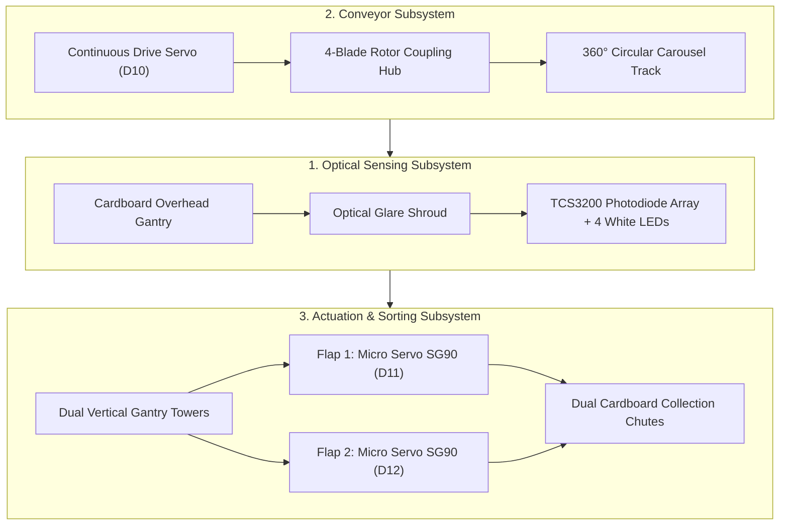
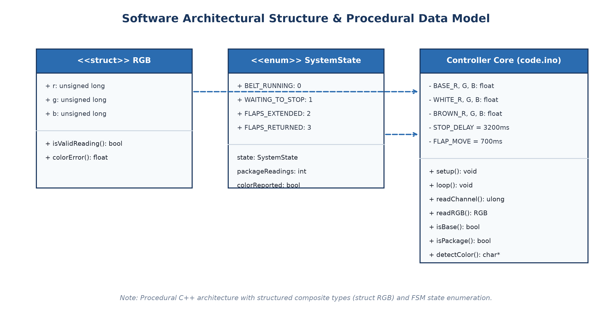
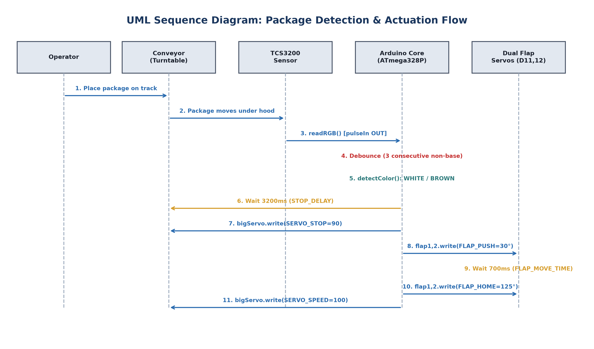
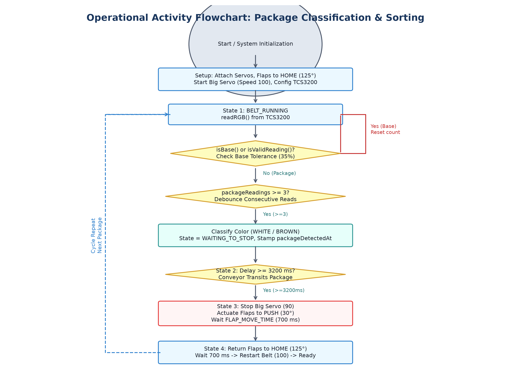

# System Architecture Specification

## 1. Architectural Overview

The **Automated Conveyor-Based Color Sorting System** is an embedded mechatronics pipeline executing closed-loop package acquisition, spectral color classification, transit timing, and electromechanical chute diversion. The platform operates as a continuous rotary carousel governed by an Arduino Uno (ATmega328P) microcontroller.

  

The system partitions into two primary layers:
1. **Physical & Electromechanical Layer:** Rotary carousel turntable, optical gantry tunnel, TCS3200 sensor array, continuous drive servo, and dual SG90 micro-servo diverter gates with dual collection bins.
2. **Embedded Software Layer:** Pulse timing frequency acquisition, baseline calibration filter, 3-sample debounce logic, normalized relative error classifier, and non-blocking Finite State Machine (FSM).

---

## 2. Electromechanical Subsystems

### 2.1 Rotary Carousel Conveyor
The physical transport mechanism uses an annular rotary carousel rather than an open linear conveyor belt. This topology allows packages to circulate continuously without dead ends or manual re-feeding during testing cycles.
- **Drive Type:** Direct center-coupled continuous rotation servo (Pin D10).
- **Speed Calibration:** Neutral/stop position at pulse width corresponding to `90` (neutral zero-torque). Continuous forward rotational speed calibrated at `100` (`SERVO_SPEED`).
- **Conveyor Surface:** Matte black treated belt surface designed to yield a low, uniform optical baseline frequency.

### 2.2 Optical Sensing Gantry
The sensor gantry straddles the carousel track at a fixed height:
- **Mounting Hood:** An inverted optical hood isolates the sensor from room ambient lighting and fluorescent tube flicker.
- **Illumination:** Four high-intensity surface-mount white LEDs integrated directly on the TCS3200 PCB provide constant, controlled incident illumination.
- **Optical Clearance:** Fixed distance allows packages up to 35 mm height to clear smoothly beneath the hood without collision.

### 2.3 Dual Flap Diverter Gates
Two mechanical deflection gates are mounted along the outer perimeter downstream of the sensor gantry:
- **Actuators:** Two TowerPro SG90 micro positional servos (Flap 1 on D11, Flap 2 on D12).
- **Home Position:** `FLAP_HOME = 125°` (retracted clear of the carousel perimeter to allow unhindered transit).
- **Actuated Position:** `FLAP_PUSH = 30°` (extended diagonally across the annular belt surface to sweep packages outward into sorting bins).

---

## 3. Sensor Signal Acquisition & Photometric Processing

The **TAOS / ams TCS3200** color sensor combines silicon photodiodes and a current-to-frequency converter on a single monolithic CMOS IC.

  

### 3.1 Frequency Scaling
Pins `S0` and `S1` configure the output frequency scale:
* `digitalWrite(S0, HIGH);`
* `digitalWrite(S1, LOW);`

This configures **20% frequency scaling** ($f_o / 5$), reducing peak output frequencies to ~100 kHz. This preserves microsecond timing resolution using Arduino's `pulseIn()` function without risking counter overflow or missed transitions.

### 3.2 Channel Selection
Photodiodes are covered with RGB and clear filters selected through control inputs `S2` and `S3`:

| Channel | S2 Pin | S3 Pin | Photodiode Grid Filtered |
|:---:|:---:|:---:|:---|
| **Red (R)** | `LOW` | `LOW` | 16 photodiodes with red selective filter |
| **Blue (B)** | `LOW` | `HIGH` | 16 photodiodes with blue selective filter |
| **Green (G)** | `HIGH` | `HIGH` | 16 photodiodes with green selective filter |
| **Clear** | `HIGH` | `LOW` | 16 photodiodes without color filter (unused) |

### 3.3 Frequency Conversion Formula
For each channel, the microcontroller sets the filter pins, waits for optical stabilization (`delay(50)`), and measures the half-period of the output square wave via `pulseIn(OUT, LOW, 100000)`:

$$\tau = \text{pulseIn}(\text{OUT}, \text{LOW}, 100000) \quad [\mu\text{s}]$$

The measured half-period duration $\tau$ is converted to full cycle frequency $f$ in Hertz ($\text{Hz}$):

$$f = \frac{1{,}000{,}000}{\tau} \quad [\text{Hz}]$$

If `pulse == 0` (timeout or sensor disconnected), the function returns `0` indicating an invalid read.

---

## 4. Mathematical Color Classification Engine

  

### 4.1 Empty Belt Baseline Discrimination
Before evaluating package colors, the incoming reading $x = (r, g, b)$ is evaluated against the empty carousel belt baseline:

$$\text{Ref}_{\text{BASE}} = (R: 4432, G: 3693, B: 4541) \quad [\text{Hz}]$$

$$\text{TOL}_{\text{BASE}} = 0.35 \quad (35\%)$$

The function `channelMatches(value, reference, tolerance)` checks:

$$|x_c - \text{Ref}_{c}| \le \text{Ref}_{c} \cdot \text{TOL}_{\text{BASE}} \quad \forall c \in \{R, G, B\}$$

If all three color channels fall within $35\%$ of the base calibration, `isBase(x)` returns `true`. If any channel deviates outside this threshold, the reading is treated as a candidate package.

### 4.2 Normalized Multi-Channel Relative Error
When a package is detected, its color signature is classified using normalized relative Euclidean deviation across all three spectral channels:

$$\epsilon_R = \frac{|x.r - \text{Ref}_R|}{\text{Ref}_R}, \quad \epsilon_G = \frac{|x.g - \text{Ref}_G|}{\text{Ref}_G}, \quad \epsilon_B = \frac{|x.b - \text{Ref}_B|}{\text{Ref}_B}$$

$$\text{colorError}(x, \text{Ref}) = \frac{\epsilon_R + \epsilon_G + \epsilon_B}{3.0}$$

### 4.3 Classification Rule
The normalized error is computed against the empirical calibrated centroids for both target package classes:

* **WHITE Package Reference:** $(R: 15531, G: 18231, B: 19863)$
* **BROWN Package Reference:** $(R: 19070, G: 13023, B: 13031)$
* **Threshold Tolerance:** $\text{COLOR\_TOLERANCE} = 0.30$ ($30\%$)

$$\text{Result} = \begin{cases}
\text{"BASE"}, & \text{if } \text{isBase}(x) \\
\text{"WHITE"}, & \text{if } \epsilon_{\text{white}} \le \epsilon_{\text{brown}} \land \epsilon_{\text{white}} \le 0.30 \\
\text{"BROWN"}, & \text{if } \epsilon_{\text{brown}} < \epsilon_{\text{white}} \land \epsilon_{\text{brown}} \le 0.30 \\
\text{"WHITE"} \text{ (fallback)}, & \text{otherwise}
\end{cases}$$

---

## 5. Finite State Machine (FSM) Specification

The system control flow is structured as a non-blocking 4-state Finite State Machine governed by timestamp differentials (`millis()`):

  

### State 1: `BELT_RUNNING`
* **Conveyor State:** Continuous rotation servo active at speed `100`.
* **Flaps State:** Both diverters held at `FLAP_HOME = 125°`.
* **Operation:** Polling TCS3200 every loop cycle. If `isPackage(x)` is true, increment `packageReadings`.
* **Transition Trigger:** When `packageReadings >= REQUIRED_PACKAGE_READINGS` (3 consecutive non-base samples), package is validated.
  * Record timestamp: `packageDetectedAt = millis()`.
  * Transition $\to$ `WAITING_TO_STOP`.

### State 2: `WAITING_TO_STOP`
* **Conveyor State:** Continues running at speed `100` for transit delay (`STOP_DELAY = 3200 ms`).
* **Flaps State:** Held at `FLAP_HOME = 125°`.
* **Operation:** Non-blocking timer countdown while physical turntable moves package from optical hood to the diversion gate.
* **Transition Trigger:** When `millis() - packageDetectedAt >= STOP_DELAY`:
  * Command belt stop: `bigServo.write(SERVO_STOP = 90)`.
  * Command dual flaps: `flap1.write(30); flap2.write(30);`.
  * Record timestamp: `flapMovedAt = millis()`.
  * Transition $\to$ `FLAPS_EXTENDED`.

### State 3: `FLAPS_EXTENDED`
* **Conveyor State:** Stationary (`90`).
* **Flaps State:** Extended at `FLAP_PUSH = 30°`.
* **Operation:** Hold flaps in extended deflection position to sweep the package into the chute.
* **Transition Trigger:** When `millis() - flapMovedAt >= FLAP_MOVE_TIME` (700 ms):
  * Command dual flaps: `flap1.write(125); flap2.write(125);`.
  * Record timestamp: `flapMovedAt = millis()`.
  * Transition $\to$ `FLAPS_RETURNED`.

### State 4: `FLAPS_RETURNED`
* **Conveyor State:** Stationary (`90`).
* **Flaps State:** Returning to `FLAP_HOME = 125°`.
* **Operation:** Allow 700 ms mechanical clearance time for servos to complete retraction.
* **Transition Trigger:** When `millis() - flapMovedAt >= FLAP_MOVE_TIME` (700 ms):
  * Restart conveyor: `bigServo.write(SERVO_SPEED = 100)`.
  * Reset counters: `packageReadings = 0; colorReported = false;`.
  * Transition $\to$ `BELT_RUNNING`.

---

## 6. End-to-End Sequence Diagram

  

The interaction timeline across the hardware components, firmware routines, and physical packages verifies that at no point does any blocking `delay()` stall the sensor polling during belt motion.

---

## 7. Data Flow and Activity Lifecycle

  

For comprehensive electrical schematics and breadboard wiring diagrams, refer to [Wiring Documentation](wiring.md).
