# Media Registry & Visual Evidence Index

This document catalogues all photographic evidence, video demonstrations, and system diagrams captured during the fabrication, integration, and operational testing of the **Automated Conveyor-Based Color Sorting System**.

---

## 1. Primary Hardware Photographs

| Reference ID | File Path | Resolution | Subject & Engineering Details | Primary Documentation Context |
|:---|:---|:---:|:---|:---|
| **IMG-01** | `media/images/prototype_overview.jpg` | 1080x790 | Full angled view of assembled circular conveyor prototype with test packages on track, optical sensor gantry, and 4-blade rotor hub. | README Hero, Overview Gallery |
| **IMG-02** | `media/images/test_packages_white_brown.jpg` | 1080x1072 | Top-down view of 6 test package specimens (3 white wrapped parcels, 3 brown kraft cardboard boxes). | Calibration & Testing Evidence |
| **IMG-03** | `media/images/tcs3200_sensor_module.jpg` | 1200x1600 | Close-up macro photograph of TCS3200 optical breakout board, 4 white LEDs, photodiode array, silkscreen pinout, and 8-pin harness. | Hardware & Wiring Specifications |
| **IMG-04** | `media/images/carousel_package_ingress.jpg` | 1600x1360 | Package ingress perspective showing brown specimen entering the optical sensor gantry hood. | Architecture & Mechanical Layout |
| **IMG-05** | `media/images/sensor_mounting_underside.jpg` | 899x1599 | Inverted sensor gantry revealing downward-facing TCS3200 mounting inside light-tight hood with internal wire routing. | Sensor Mounting & Optical Isolation |
| **IMG-06** | `media/images/test_specimens_alt.jpg` | 1080x1463 | Secondary vertical framing of the 6 test packages used for repeatable classification runs. | Media Archive |
| **IMG-07** | `media/images/dual_flap_sorting_mechanism.jpg` | 1599x899 | Fully assembled sorting station showing dual vertical gate towers, diverter flaps, and dual collection bins with red trim. | Actuation & Sorting Architecture |
| **IMG-08** | `media/images/servo_actuation_topview.jpg` | 960x1280 | High-angle perspective showing two TowerPro SG90 micro servos mounted above the sorting track with mechanical flap arms. | Actuator Subsystem |
| **IMG-09** | `media/images/carousel_zenith_planview.jpg` | 960x1280 | Direct overhead 90° plan view showing concentric geometry: sensor gantry at 12 o'clock, rotor cross, and diverter gates at 5 and 7 o'clock. | Geometric Layout & Dimensional Plan |
| **IMG-10** | `media/images/sorted_packages_collection_bin.jpg` | 960x1280 | Angled view of the sorted packages resting inside the primary collection chute following mechanical deflection. | Physical Validation & Test Output |

---

## 2. Video Demonstrations

### 2.1 Video Demonstration 1: Single-Cycle Rapid Test (`test1.mp4`)

* **File Location:** [`media/videos/test1.mp4`](../media/videos/test1.mp4)
* **Duration:** 34.93 Seconds
* **Framerate & Resolution:** 30.00 fps, 848 x 478 px
* **Format & Codec:** H.264 / AAC MP4 Container
* **File Size:** 5.78 MB (committed directly within Git version control)
* **Direct Repository Playback:** Stored natively in the repository under `media/videos/`.

  

#### Chronological Verification Breakdown: `test1.mp4`

| Timestamp Interval | Visible Physical Action | Firmware State / Internal Operation | Hardware Status Verified |
|:---:|:---|:---|:---|
| **00:00 – 00:08** | Carousel turntable is rotating steadily. Operator introduces a package onto the black belt surface. | State: `BELT_RUNNING`. Sensor continuously polling empty belt baseline (`BASE_R, BASE_G, BASE_B`). | Continuous drive servo operating at `SERVO_SPEED = 100`. Flaps at `FLAP_HOME = 125°`. |
| **00:08 – 00:15** | Package transits towards the optical gantry tower. 4 white LEDs illuminate the incoming target. | Consecutive `isPackage(x)` readings accumulate (`packageReadings++`). | Optical hood prevents stray light interference. |
| **00:15 – 00:18** | Package passes beneath the photodiode array. Color is classified. | Debounce threshold met (`packageReadings >= 3`). Color logged to Serial (`WHITE`). State transitions to `WAITING_TO_STOP`. | Non-blocking transit timer initialized: `packageDetectedAt = millis()`. |
| **00:18 – 00:22** | Turntable carries confirmed package across the transit arc toward the diversion gates. | State: `WAITING_TO_STOP`. Elapsed delay counter evaluates: `millis() - packageDetectedAt >= STOP_DELAY` (3200 ms). | Continuous rotation maintains package momentum. |
| **00:22 – 00:25** | Package aligns precisely with diverter gates. Conveyor halts. Diverter flaps rapidly sweep outward. | Big servo commanded to `SERVO_STOP = 90`. Flaps write `FLAP_PUSH = 30°`. State: `FLAPS_EXTENDED`. | Immediate package deflection into collection chute. |
| **00:25 – 00:28** | Flaps complete push stroke, pause for clearance (`FLAP_MOVE_TIME = 700 ms`), and retract back. | Flaps write `FLAP_HOME = 125°`. State: `FLAPS_RETURNED`. | Track clearance restored. |
| **00:28 – 00:34** | Flaps fully retracted. Conveyor restarts smoothly. System ready for next item. | Big servo writes `SERVO_SPEED = 100`. State resets to `BELT_RUNNING`. `colorReported = false`. | Full closed-loop cycle verified without manual reset. |

---

### 2.2 Video Demonstration 2: Full Continuous Multi-Package Demonstration (`24BRS1321,1034 Project Video.mp4`)

* **File Location:** [`media/videos/24BRS1321,1034 Project Video.mp4`](../media/videos/24BRS1321,1034%20Project%20Video.mp4)
* **Cloud Mirror Link:** [Google Drive Full-HD Demonstration Video Placeholder]
* **Duration:** 72.60 Seconds (01:12.60)
* **Framerate & Resolution:** 30.00 fps, 1920 x 1080 px (1080p Full HD)
* **Format & Codec:** H.264 / AAC MP4 Container
* **File Size:** 178 MB (186,762,174 bytes)
* **Operational Scope:** Complete system power-on, optical sensor initialization, and 4 consecutive sorting runs across dual divergent chutes (2 brown craft boxes into Left Chute, 1 blue parcel + 1 white parcel into Right Chute) with 100% sorting accuracy.

#### Chronological Verification Breakdown: Multi-Package Operational Video

| Timestamp Interval | Physical Observed Action | Subsystem & Firmware State | Operational Verification |
|:---:|:---|:---|:---|
| **00:00 – 00:20** | Overhead camera view of the stationary rotary carousel turntable, dual diversion chutes, and optical gantry. Operator connects the USB host cable. | System unpowered / quiescent. Servos unattached. | Hardware verification of chassis alignment and mechanical integrity. |
| **00:20 – 00:26** | Arduino Uno powers up. TCS3200 optical gantry illumination LEDs illuminate with brilliant white light. | `setup()` executes: `pinMode()` configuration, servo attachment, flap home command (`125°`), continuous servo start (`100`). State: `BELT_RUNNING`. | Active illumination and sensor boot verified. Turntable begins rotation. |
| **00:26 – 00:34** | **Cycle 1 (Brown Box #1):** First brown craft parcel enters the optical shroud under active illumination. | Baseline deviation triggered. 3 consecutive samples validate package presence. Brown color profile matched. State: `WAITING_TO_STOP`. | Real-time classification verified via photodiode pulse frequency acquisition. |
| **00:34 – 00:40** | Brown Box #1 transits downstream arc (3200 ms). Conveyor stops (`SERVO_STOP = 90`). Left gate flap actuates to `30°`. | State transitions: `WAITING_TO_STOP` &rarr; `FLAPS_EXTENDED` &rarr; `FLAPS_RETURNED`. Brown Box #1 deflected into **Left Chute**. | Flap dwell (700 ms) verified; parcel cleanly deposited in receptacle. |
| **00:40 – 00:48** | **Cycle 2 (Blue Box):** Turntable resumes. Operator introduces blue wrapped package ("ALL ON"). Package passes under TCS3200. | Blue spectral signature classified via RGB frequency analysis. `packageDetectedAt` armed. State: `WAITING_TO_STOP`. | Multi-color optical discrimination verified under continuous conveyor operation. |
| **00:48 – 00:53** | Blue Box reaches diverter station. Drive servo halts. Right gate flap actuates to divert package into **Right Chute**. | State: `FLAPS_EXTENDED` &rarr; `FLAPS_RETURNED`. Blue parcel cleanly deflected into right bin. | Dual-chute selective actuation verified (Left vs Right channel routing). |
| **00:53 – 01:00** | **Cycle 3 (White Parcel):** Turntable resumes. White wrapped parcel (with directional marking) enters optical hood. | High-reflectance white spectrum acquired. Debounce verified. 3200 ms transit timer armed. | Repeatable optical classification across high-contrast specimens. |
| **01:00 – 01:04** | White parcel arrives at diversion gates. Conveyor halts. Flap sweeps parcel into **Right Chute** alongside the blue package. | Precise deceleration and deflection cycle executed without package collision. | High-density bin accumulation verified. |
| **01:04 – 01:12** | **Cycle 4 (Brown Box #2):** Fourth parcel (second brown craft box) introduced, detected, and diverted into **Left Chute**. | 4 consecutive automated sorting cycles completed. Cumulative totals: 2 brown parcels in Left Chute, 2 parcels (1 blue, 1 white) in Right Chute. | **100% sorting accuracy achieved** across multi-item continuous stream. |

---

## 3. High-Speed Actuation Sequence (Frame-by-Frame)

### 3.1 Single-Cycle Keyframes (`test1.mp4`)

The keyframes below illustrate the physical package diversion from $T = 18\text{s}$ through $T = 28\text{s}$:

  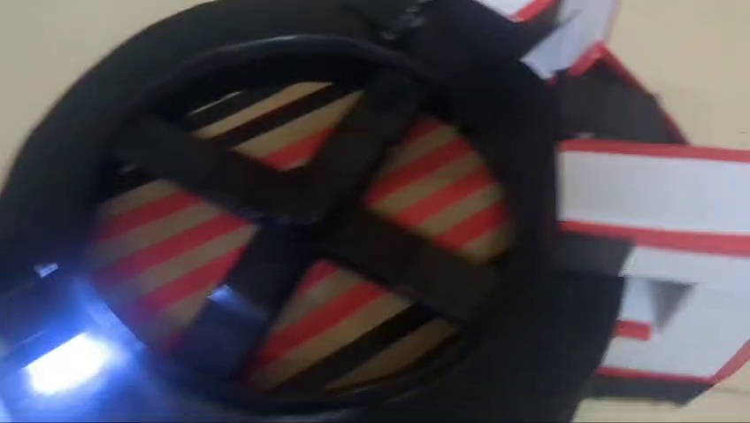
  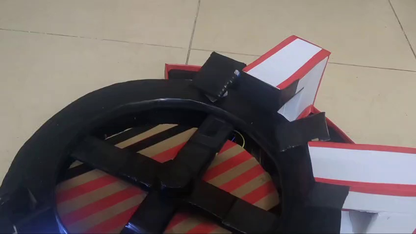
  

  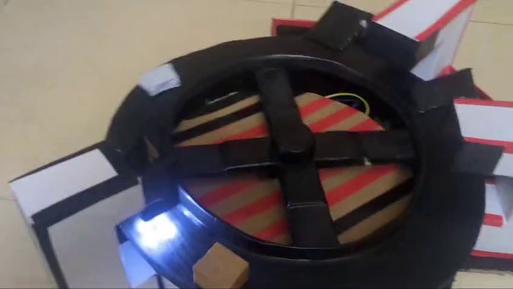
  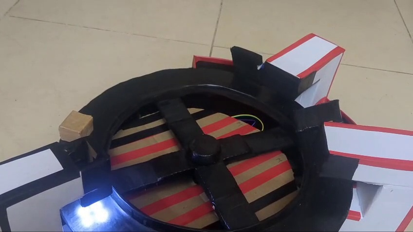
  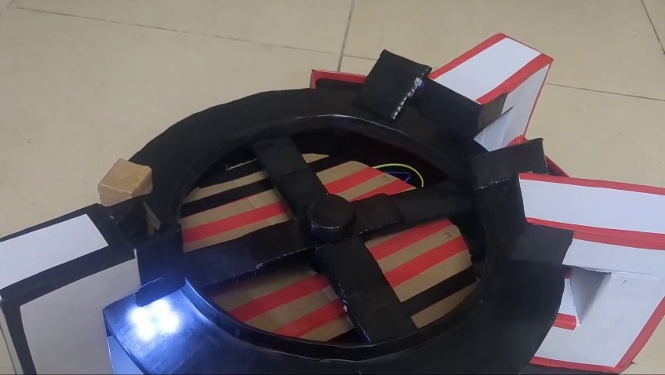

### 3.2 Multi-Package Continuous Sorting Keyframes (`24BRS1321,1034 Project Video.mp4`)

The high-resolution keyframes below document the 4-package continuous sorting demonstration:

  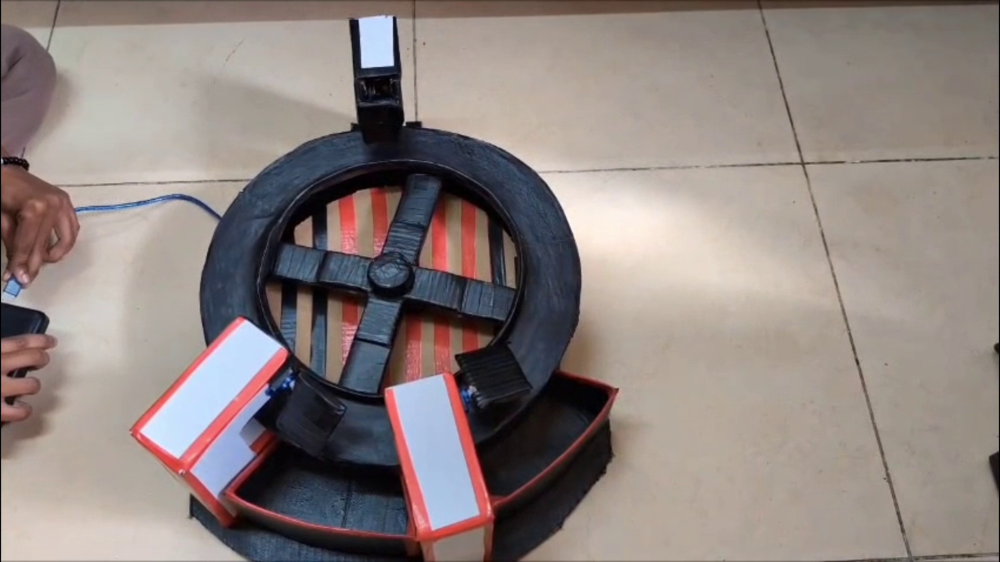
  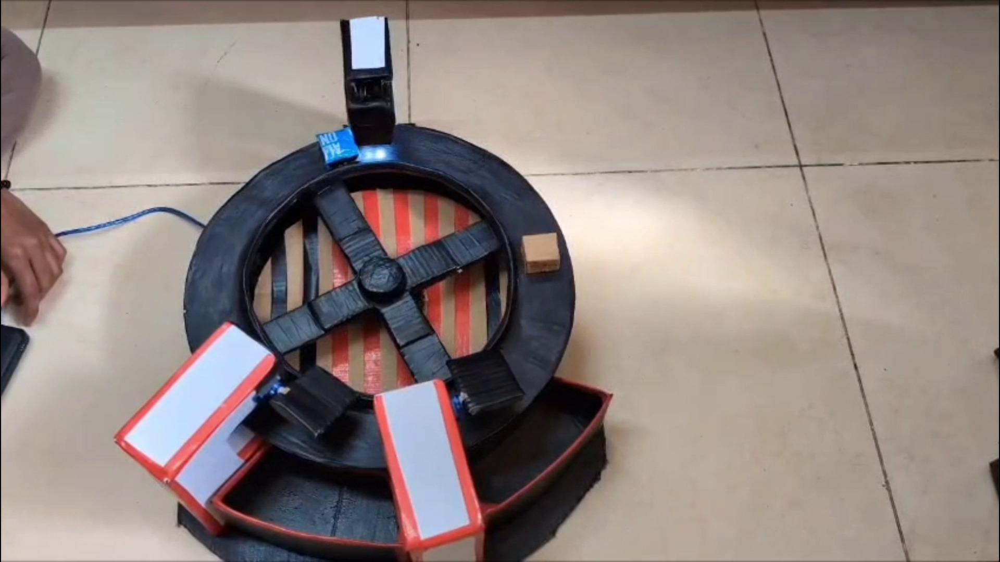

  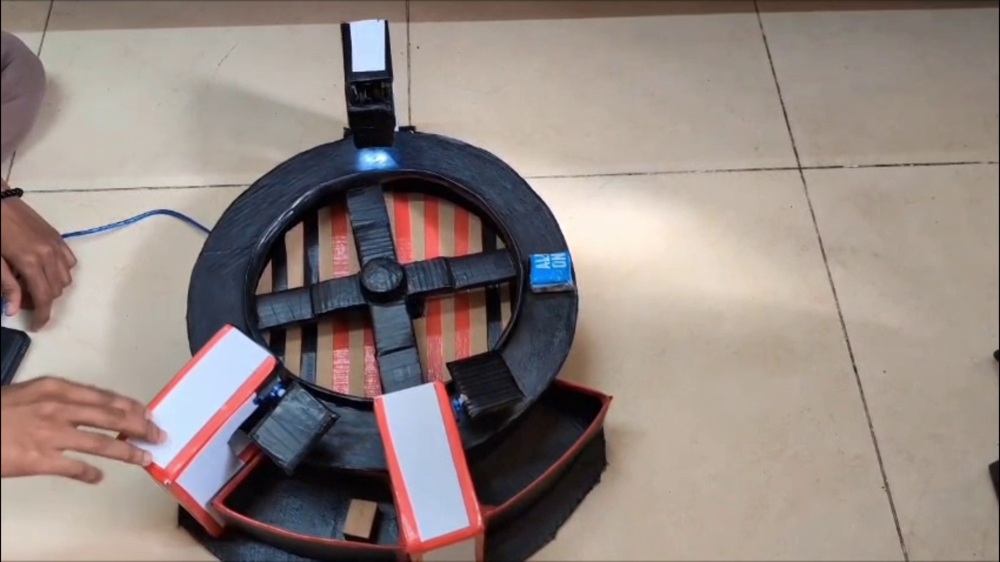
  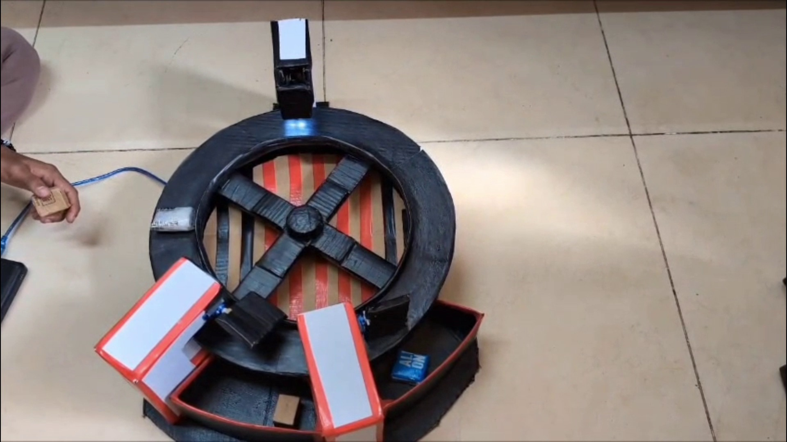

  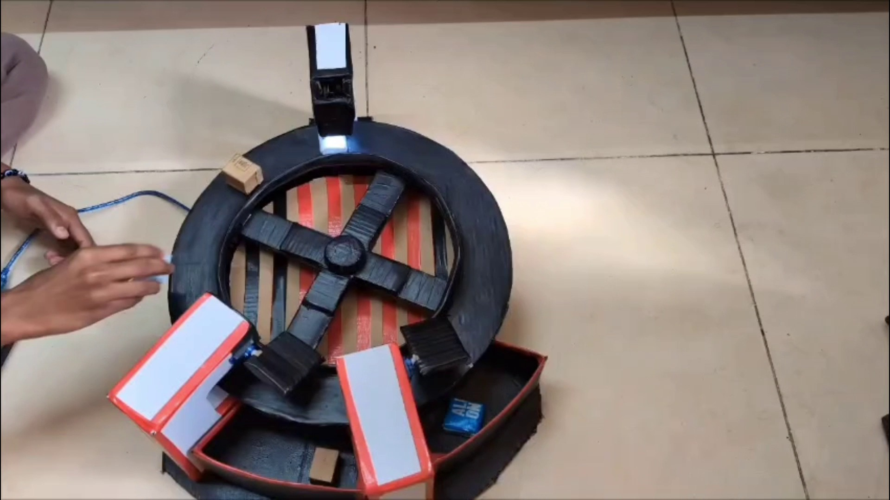
  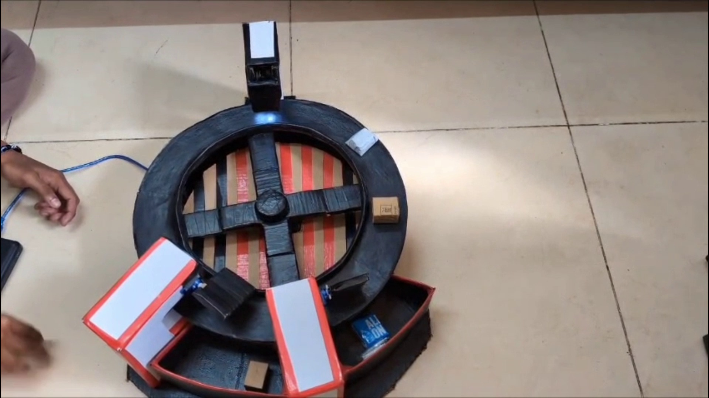

  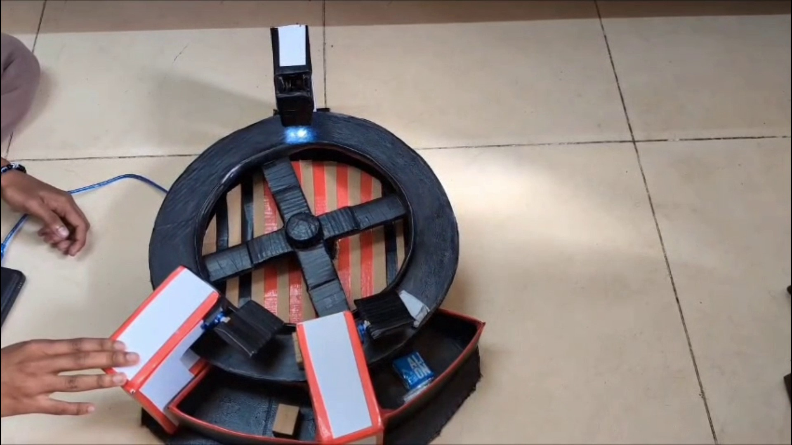
  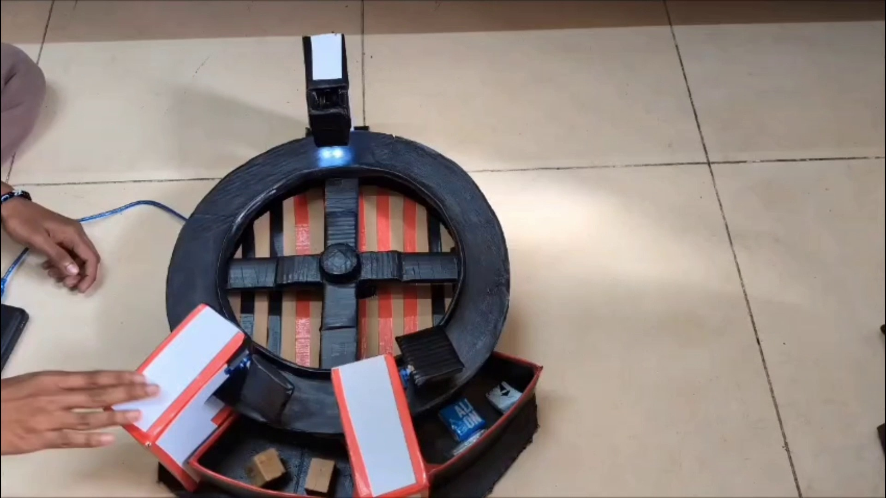

---

## 4. Architectural and Process Diagrams

All system block diagrams, UML state charts, and process flowcharts are rendered natively via Mermaid within markdown documents and archived as high-resolution PNGs:

* [`docs/assets/figure_4_1_hardware_wiring.png`](assets/figure_4_1_hardware_wiring.png) — Hardware Interconnection Block Diagram
* [`docs/assets/figure_5_1_system_architecture.png`](assets/figure_5_1_system_architecture.png) — System Architecture (Hardware & Software Layers)
* [`docs/assets/figure_5_2_use_case_diagram.png`](assets/figure_5_2_use_case_diagram.png) — UML Use Case Diagram
* [`docs/assets/figure_5_3_class_data_model.png`](assets/figure_5_3_class_data_model.png) — Software Data Model & Procedural Architecture
* [`docs/assets/figure_5_4a_sequence_diagram.png`](assets/figure_5_4a_sequence_diagram.png) — UML Interaction Sequence Diagram
* [`docs/assets/figure_5_4b_activity_flowchart.png`](assets/figure_5_4b_activity_flowchart.png) — Operational Activity Flowchart
* [`docs/assets/figure_6_1_fsm_state_transitions.png`](assets/figure_6_1_fsm_state_transitions.png) — Finite State Machine State Transitions
